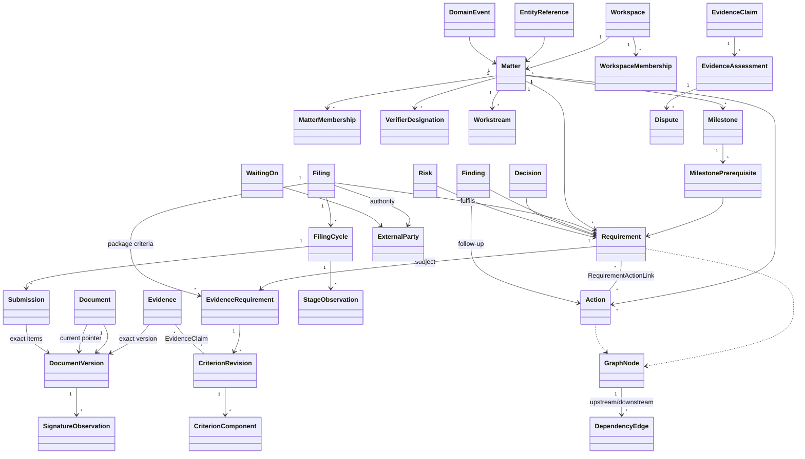

# Domain Model

- Author: Claude Code (actual), claude-opus-5-5, MC-002-ARCH, packet-only.
- Inputs: requirements `572835a` / approval `54e1db5`; backend `d024e3ec9dd96abf9ada1d7516f1b2f0e8cba67b`; frontend `3e5a642479acb789eb210e73fba956f3e85082e3`.
- Status: **PROPOSED / NOT_IMPLEMENTED / WAITING_ARCHITECTURE_APPROVAL**.

## 1. Principles

- Every glossary concept is a distinct Go type with its own invariants and its own table. No `Item{Kind, Metadata map[string]any}`.
- Aggregates are constructed through validating constructors and mutated only through methods returning a new value plus domain events (the template `User.Apply` pattern: pure, no mutation of the original).
- All references inside a Matter carry `MatterID`; repositories enforce same-matter references and the database enforces them again with composite foreign keys.
- IDs are UUIDv7 typed wrappers (`RequirementID`, `ActionID`, …) so a Requirement ID cannot be passed where an Action ID is expected.
- Times are `time.Time` UTC instants (µs, matching PostgreSQL). Date-only inputs are rejected unless accompanied by an explicit zone and resolved to an instant (NFR-011).

## 2. Concept map



## 3. Access context

| Type | Key fields | Invariants |
|---|---|---|
| `Workspace` | ID, Name, Revision | Contains matters; not a legal entity |
| `WorkspaceMembership` | WorkspaceID, UserID, Role {OWNER, MEMBER}, Status {ACTIVE, REVOKED}, Revision | Workspace OWNER administers workspace membership and matter creation only; grants no matter read |
| `MatterMembership` | MatterID, UserID, Role {OWNER, EDITOR, VIEWER}, Status, Revision | Requires ACTIVE workspace membership; ≥1 *effective* OWNER always (matter OWNER ∧ ACTIVE ∧ workspace membership ACTIVE), guarded on matter demotion/revocation **and** workspace revocation (data-model §2); never created by import or assignment |
| `VerifierDesignation` | MatterID, UserID, Active, DesignatedBy, Reason, Revision | Holder must be matter EDITOR or OWNER at verification time; OWNER role alone confers nothing |
| `Actor` (value) | UserID or `SYSTEM_CLOCK` | System actor only for boundary materialization; never for business decisions |

## 4. Matter operations context

```go
type ExecutionState string // NOT_STARTED, IN_PROGRESS, WAITING, COMPLETED, CANCELLED
type VerificationState string // NOT_REQUIRED, UNVERIFIED, PARTIALLY_VERIFIED, VERIFIED, DISPUTED
type DependencyState string // READY, BLOCKED

type WorkNode struct { // embedded by Requirement and Action; maps to graph_nodes supertype
    ID         NodeID
    MatterID   MatterID
    Kind       NodeKind // REQUIREMENT | ACTION
    Title      string
    OwnerUser  *UserID   // internal accountable owner; must be active matter member
    DueAt      *time.Time
    Execution  ExecutionState
    Dependency DependencyState // derived, persisted, never client-writable
    CompletedAt, CancelledAt *time.Time
    CriticalEscalation *Escalation // OWNER reasoned escalation (RULE-010)
    Revision   int64
}

type Requirement struct {
    WorkNode
    Outcome             string          // condition/outcome text, required
    WorkstreamID        *WorkstreamID
    Verification        VerificationState // derived aggregate (proof context)
    ProofEpoch          int32           // incremented by reopen, never decremented; older-epoch assessments stop counting
    ProofEpochOpenedAt  *time.Time      // t_cmd of the reopen that opened the current epoch (nil for epoch 0)
    VerificationApplicability Applicability // REQUIRED | NOT_REQUIRED{reason, decidedBy}
    ImportedVerificationClaim *string   // RULE-014: retained claim, never authority
}

type Action struct {
    WorkNode
    WorkstreamID  *WorkstreamID
    ProofRequired bool              // Verification applies only if true (state-semantics)
    Verification  *VerificationState
    ProofEpoch    int32
    ProofEpochOpenedAt *time.Time
}
```

| Type | Notes |
|---|---|
| `RequirementActionLink` | (RequirementID, ActionID), M:N, informational contribution; **no state propagation in either direction** (RULE-001) |
| `Workstream` | Grouping within a Matter; not a Milestone |
| `Milestone` | DueAt, Critical bool (OWNER, reasoned), derived `Readiness {UNASSESSED, READY, NOT_READY}`, satisfied/total counts |
| `MilestonePrerequisite` | (MilestoneID, RequirementID), OWNER-only add/remove with reason |
| `WaitingOn` | Subject (node or filing), Party *ExternalPartyID or Condition text, InternalOwner, Reason, FollowUpDueAt, ResolvedAt, ResponseReference; requires reason + internal owner |

## 5. Graph context

`DependencyEdge{ID, MatterID, Upstream NodeID, Downstream NodeID, Gate {COMPLETION, COMPLETION_AND_VERIFIED}, Reason, CreatedBy, RemovedAt, RemovalReason, Revision}`. Invariants and algorithms: [dependency-engine.md](dependency-engine.md).

## 6. Proof context

| Type | Key fields | Invariants |
|---|---|---|
| `EvidenceRequirement` | ID, MatterID, Subject {NodeID or FilingID}, CurrentRevisionID, Retired | Criterion definition; distinct from proof |
| `CriterionRevision` | RevNo, Mandatory, Applicable(+reason), AcceptableProof, VersionRule {CURRENT_AUTHORITATIVE(DocumentID), FIXED(DocumentVersionID), NONE}, ValidityRequired, Components[], Reason, CreatedBy | Immutable; new revision supersedes; stale-revision assessments stop counting |
| `CriterionComponent` | Key, Label, Mandatory | Supports partial verification of one criterion (e.g., per-signatory signature) |
| `Evidence` | ID, MatterID, Kind {DOCUMENT_VERSION, EXTERNAL_REFERENCE, OBSERVATION}, DocumentVersionID, ExternalReference, ValidFrom, ValidUntil, SubmittedBy, WithdrawnAt | Immutable after submission; replacement is a new record; positive validity interval |
| `EvidenceClaim` | EvidenceID, CriterionRevisionID, ComponentKey (nil = implicit single component), ClaimedBy, Revision | The M:N link; acceptance scoped to this triple; exactly one subject (via its criterion); Revision is the CAS target for assess/revoke/dispute |
| `EvidenceAssessment` | ClaimID, SubjectEpoch, Verdict {ACCEPTED, REJECTED}, Reviewer, Rationale, AssessedVersionID, EffectiveUntil, SupersededByID, RevokedAt/By/Reason | Reviewer ∉ {evidence submitter, claimant}; reviewer designated and EDITOR/OWNER; SubjectEpoch = subject's current epoch at insert; exactly one current (non-superseded) assessment per (claim, epoch) = canonical verdict |
| `Dispute` | AssessmentID, RaisedBy, Reason, ResolvedBy, Outcome {UPHOLD, REVOKE}, Rationale | Resolver is designated, independent of evidence submitter/claimant |

Details: [evidence-model.md](evidence-model.md).

## 7. Documents and filing

- `Document{ID, MatterID, Title, CurrentVersionID *, Revision}`; `DocumentVersion{ID, DocumentID, Seq, Source {CONTENT, EXTERNAL_REFERENCE}, ContentObjectID, SHA256, Size, MediaType, PredecessorID, UploadedBy, Availability}`; `SignatureObservation{VersionID, Signatory {PartyID or EntityRefID or label}, Observed {SIGNED, NOT_SIGNED, DECLINED}, EvidenceID *, ObservedAt}` — see [document-lineage.md](document-lineage.md).
- `Filing{ID, MatterID, RequirementID, AuthorityPartyID, Owner, Stage, Execution, ProofRequired, Verification *, ProofEpoch, ProofEpochOpenedAt *, DueAt, NegativeOutcome *, NegativeOutcomeEpoch *}`, `FilingCycle{CycleNo, OpenedInEpoch, …}`, `StageObservation`, `Submission{CycleID, Reference, SubmittedAt, Items[]DocumentVersionID}` — see [filing-model.md](filing-model.md).

## 8. Basic legal context (P0, RULE-020)

| Type | Fields | Lifecycle |
|---|---|---|
| `ExternalParty` | Label, Role/context, ContactReference (scoped, sensitive), Active | Inactivation preserves history; blocked while it has open waits unless waits are reassigned or resolved |
| `EntityReference` | Label, EntityKind (organization, person, other), ExternalIdentifier optional | Contextual reference only; not a user, not a party, not an Entity Master (P1) |
| `Decision` | Question, Owner, Status {OPEN, DECIDED, SUPERSEDED}, Outcome, Rationale, DecidedAt, related node IDs | OPEN visible in Control Room; supersession creates a new Decision |
| `Finding` | ObservedGap, Owner, Status {OPEN, RESOLVED}, FollowUpActionID, ResolutionEvidenceIDs, ResolutionNote | Resolution requires a reference; never deletes gap history |
| `Risk` | Description, Owner, Status {OPEN, MITIGATED, ACCEPTED, CLOSED}, Response | Does not drive attention automatically (no inference from narrative) |

These records have a simple status field, not the five axes (state-semantics: basic contextual records). Typed link tables connect them to nodes (`finding_subjects`, `decision_subjects`, `risk_subjects`, `entity_reference_links`).

## 9. Extension paths (P1/P2), not implemented

| Capability | Extension | Compatibility kept now |
|---|---|---|
| P1-03 Open Legal Questions | New aggregate `LegalQuestion{Question, Status {OPEN, ANSWERED, WITHDRAWN}, Answer, AuthorityRefs}` and table `legal_questions`; Decision gains nullable `legal_question_id` (expand-only migration). Event type namespace `legal_question.*` reserved | Decision kept distinct from Legal Question now |
| P1-01/02 Authorities/Propositions | Separate aggregates linked to LegalQuestion | None needed |
| P1-04 Structured Decisions | Options/criteria sub-records under Decision | Decision ID stable |
| P1-05/06/07 Entity Master, temporal relations, ownership provenance | `EntityReference` gains nullable `entity_id`; temporal relation tables | Entity separate from ExternalParty |
| P1-09 Signature Tracking | Builds on `SignatureObservation` keyed by exact version | Version-pinned observations |
| P1-10 Advanced Filing Packages | Package templates generating criteria | Criteria already per filing |
| P1-12/13/14 Saved views, management exports, historical snapshots | Snapshot store separate from drafts | P0 never claims issued snapshots |
| P2 AI features | Must cite events/versions; never write domain state directly | Event history is the grounding source |

## 10. Domain event catalogue (excerpt)

Event types are typed Go structs with a schema version; the persisted payload is the serialized struct (see data-model §6). Examples: `requirement.created`, `node.execution_changed`, `node.execution_corrected`, `node.dependency_derived`, `node.verification_derived`, `node.timing_boundary_crossed`, `node.attention_derived`, `edge.added`, `edge.removed`, `criterion.revised`, `criterion.applicability_changed`, `evidence.submitted`, `evidence.claimed`, `evidence.withdrawn`, `assessment.recorded`, `assessment.revoked`, `assessment.expired`, `dispute.raised`, `dispute.resolved`, `subject.verification_applicability_decided`, `document.version_added`, `document.version_promoted`, `signature.observed`, `filing.stage_observed`, `filing.cycle_opened`, `filing.submitted`, `filing.negative_outcome_recorded`, `filing.cancelled`, `filing.reopened`, `subject.proof_epoch_advanced`, `assessment.superseded`, `waiting.set`, `waiting.resolved`, `membership.granted`, `membership.revoked`, `verifier.designated`, `milestone.prerequisite_changed`, `milestone.readiness_derived`, `import.group_applied`, `bulk.row_applied`.

## 11. Domain tests

| Test | AC |
|---|---|
| Completing an Action changes no linked Requirement field (property test over random links) | AC-101 |
| Constructors reject empty title/outcome, wrong-kind IDs, cross-matter references | AC-101, AC-135 |
| Finding/Decision/Risk/EntityReference remain distinct types in API and history | AC-159 |
| Import cannot construct MatterMembership or ACCEPTED assessment | AC-113, AC-158 |
