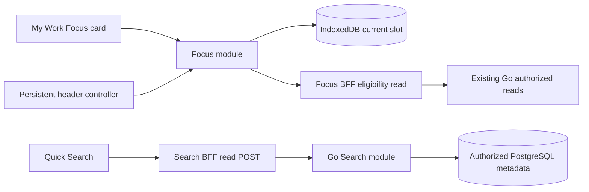

# Focus + Quick Search — implementation design package

Task **MC-FOCUS-SEARCH-CODEBASE-DESIGN-20261101**, Local Codex, 2026-11-01. **DESIGN_CANDIDATE / READY_FOR_ENGINEERING_HANDOFF**. Product implementation NOT_STARTED by this task; independent design review, feature acceptance and deployment proof are not claimed. The direct PO request authorizes this codebase design. Existing BRDs remain versioned proposals; this package makes implementation choices explicit without silently rewriting approved legal policy or claiming PO approval of new SLOs.

Repository: `/Users/nguyenvanlan/Documents/code/pet-projects/matter-control`, branch `codex/unified-project-flow`, HEAD `978d8fc694a47e9beee528076bcf1af9473997e3` plus preserved dirty UI work. Source/data layout changes during a later engineering task require a fresh reconciliation, not a reset to this head.

## 1. Deliverables and chosen seams

| Module                | Design                                         | Chosen implementation                                                                                                                         | External caller knowledge                                                                  |
| --------------------- | ---------------------------------------------- | --------------------------------------------------------------------------------------------------------------------------------------------- | ------------------------------------------------------------------------------------------ |
| Focus                 | [Focus module](focus-module-design.md)         | Work feature, pure state transitions, IndexedDB atomic coordinator, BroadcastChannel notifications, existing Go eligibility reads through BFF | Provider, current view, dispatch; no deadline/storage/authorization arithmetic in buttons  |
| Quick Search          | [Search module](quick-search-module-design.md) | Search feature → same-origin read-POST BFF → one Go search use case → authorized PostgreSQL metadata queries                                  | Typed query/group cursor/result; no client list fan-out or scope filtering                 |
| Shared technical seam | Sections below                                 | Token-free session projection and two privacy invalidation events                                                                             | Opaque principal/epoch/expiry, session-ended/access-recheck; no token-bearing global store |

The shared authenticated app composes both modules; neither imports the other. Search results are read navigation only and never invoke Focus or domain commands. Focus's candidate picker uses server `next`, not global Search ranking. No SQL Focus history, worker, scheduler, queue or external search engine is introduced.

## 2. Design choices, alternatives and limits

| Decision               | Selection / reason                                                                              | Rejected or deferred alternative                                                                                                         |
| ---------------------- | ----------------------------------------------------------------------------------------------- | ---------------------------------------------------------------------------------------------------------------------------------------- |
| CD-F01 storage         | One singleton IDB slot with CAS revision/generation; metadata-only terminal tombstone           | localStorage locking is non-atomic; separate per-tab timers violate BRD; Web Locks is unnecessary with IDB transactions                  |
| CD-F02 Focus ownership | `features/work/focus`; one persistent provider and two UI callers                               | A separate feature importing Work repositories violates current feature import rules; global feature framework is not needed             |
| CD-F03 validation      | Existing `/me/actions`, scoped detail and Matter reads, orchestrated in an app BFF route        | No new Go Focus command; do not recompute Next Action ranking in browser                                                                 |
| CD-S01 retrieval       | Four metadata groups in Go/SQL, no new indexed corpus                                           | Frontend first-page filtering misses matches; Elasticsearch/AI/file-content indexing adds scope/cost/privacy obligations                 |
| CD-S02 protocol        | POST body on browser and Go legs; narrow shared transport read semantics                        | GET q would expose legal terms to URL/access logs; current POST-command error mapping is wrong for a search read                         |
| CD-S03 paging          | AEAD cursor, authorized projection fingerprint and explicit stale reset                         | Base64 leaks label keys; keyset alone cannot guarantee no gaps after rename/membership changes; no retained cross-request DB transaction |
| CD-S04 text            | Versioned EN/VI NFD/diacritic/`đ`/root-lower profile; literal substring; shared adapter vectors | No locale-default/ASCII fallback, no PostgreSQL18-only full-casefold dependency, no fuzzy linguistic equivalence promise                 |
| CD-C01 identity        | Server projects principal key + per-login epoch + expiry, supplied at app composition           | Draft namespace alone is per-session, not principal identity; raw Session includes bearer and must not reach client                      |

Implementation defaults (not production commitments): Focus15/25/50, default25, +5, proposed visible refresh20s with30s maximum successful-read age; Search2–100 code points,200ms debounce after IME composition,5/page/max25, proposed5-minute navigation cursor TTL. These values do not change token-cache TTL, due-soon rules, existing record retention, workload/RPO/RTO, release or cost approval.

Two narrow BRD interpretations are called out for reviewer intake: Focus retains only a content-free generation fence after deleting an active record, and Search guarantees EN/VI matching rather than full international linguistic/case-expansion equivalence. No active history survives the fence. If those interpretations are rejected, revise the design explicitly; do not silently weaken the runtime acceptance cases.

## 3. Shared composition and dependency classification

| Dependency                         | Skill category      | Seam / test strategy                                                                                                      |
| ---------------------------------- | ------------------- | ------------------------------------------------------------------------------------------------------------------------- |
| Timer and query/ranking arithmetic | In-process          | Pure model tests through observable transitions/results                                                                   |
| IDB and browser notification       | Local platform I/O  | Internal coordinator seam: in-memory reference for race/error tests; actual two-tab IDB execution remains mandatory       |
| BFF-to-Go reads                    | Remote but owned    | Existing repository adapters; injected reads for Focus and typed Search transport tests                                   |
| PostgreSQL search                  | Local-substitutable | Existing memory + real disposable PostgreSQL adapters, same contract matrix                                               |
| ZITADEL                            | True external       | Existing auth integration; no new provider policy/credentials; synthetic fixture tests do not replace real IdP acceptance |

App composition resolves public identity under request-time Suspense. Wrap existing template/children in the persistent Focus provider; pass the same identity to QuickSearch and retain the existing draft namespace for forms. Resolve tokens server-side only. A failed identity read shows safe static navigation and the existing failure UX, not stale protected context or a broken whole workbench.

Keep `MyActionsView` server-friendly; insert a client FocusCard leaf. Keep the existing DashboardTemplate header/bottom slots and four navigation destinations. Expanded Focus controls and Quick Search both use the corrected shared native Dialog, so opening a controller cannot remount page forms or reset UNKNOWN attempts. Shortcut handling must not steal focus from another modal.

`lib/mc/private-ui-events.ts` is a client-only two-event seam with no domain imports. Real consumers are Focus and Search; sources are explicit auth/primary-read failure handling. It is not an application event bus. Unknown-scope denial triggers a recheck, not a claim that the running target was revoked; partial failures retain existing behavior. No new event may call a form discard or resend a business command.

All imports follow existing `app → features → components/lib` and Go inward-only rules. Generated sqlc files are generated, never hand-edited. New interfaces must earn their depth; avoid one-file-per-command wrappers, a generic plugin registry, framework-wide state rewrite or TS deep-module tooling setup. The selected skill does not request installing another plugin.

## 4. Contract delta register

All entries are proposals to implement, test and document with the candidate, not routes verified today.

| Change                                            | Where it belongs                                              | Compatibility / gate                                                                             |
| ------------------------------------------------- | ------------------------------------------------------------- | ------------------------------------------------------------------------------------------------ |
| Public UI session projection                      | `lib/ui-session.ts`, server auth projection, app composition  | Additive; no token/handle serialization; existing drafts unchanged                               |
| `POST /api/focus/eligibility`                     | Next BFF route + Work Focus eligibility implementation        | Existing Go reads only; origin/session/epoch/body/error tests                                    |
| `POST /api/search` → `POST /api/v1/search`        | Next Search module + Go inbound port/handler                  | New authenticated read; private/no-store, bounds, actor derived by Go                            |
| `mcRequest semantics:'read'` on exact Search POST | Existing technical HTTP module                                | Defaults unchanged; positive allowlist plus negative ordinary-command UNKNOWN tests              |
| `ui-session-changed` / `search-stale` problems    | Explicit new route/result error schemas and contract docs     | Do not reinterpret existing409 Filing/graph or412/428 meanings                                   |
| Search support SQL objects                        | Next-unused additive migration after current0011, sqlc inputs | Preflight PG17/18 UTF8+ICU on disposable fixtures; no live migration from this task              |
| `MC_SEARCH_CURSOR_KEY`                            | Go config/composition, example and ops docs                   | Dedicated synthetic local secret for tests; shared production secret later; no IdP/BFF key reuse |
| Focus IDB schema1                                 | Client implementation only                                    | No PostgreSQL table/migration; terminal generation fence has no active reference/history         |

Update `docs/implementation/p0-zcode-execution/local-contract.md`, backend `docs/api.md` and config/ops docs alongside actual implementation, using the current contract revision at that time. This design does not bump that executable contract or alter baseline pass/fail ledgers in advance.

## 5. One continuous implementation plan

Use one primary writer for shared source. Stages are dependency/checkpoint boundaries, not repeated requests to the PO to continue. A future explicit assignment can implement the selected bounded profile through a complete local candidate; material new business/provider/cost/retention choices still return with concrete alternatives.

| Work package                 | Deliverable / dependency                                                                                | Completion evidence                                                                                |
| ---------------------------- | ------------------------------------------------------------------------------------------------------- | -------------------------------------------------------------------------------------------------- |
| FS-01 identity/privacy seams | Reconcile dirty source; public projection, app placement, logout/read-error notifications               | No bearer serialized; identity-switch/purge/partial-denial and existing draft/UNKNOWN tests        |
| FS-02 Focus core             | Model + IDB coordinator/reference adapter; depends FS-01                                                | Fake-clock/race/ABA/corrupt-storage tests, no independent per-tab fallback                         |
| FS-03 Focus end-to-end       | BFF eligibility, My Work card, persistent controller; depends FS-02                                     | Exact candidate/refresh/error semantics, real2-tab browser checks, zero-domain-write evidence      |
| FS-04 Search backend         | Normalizer vectors/support migration, authorized snapshots, fingerprint/cursor, Go handler/config       | Memory+PG isolation/>200/pagination/tamper/plan cases; no hidden-data-dependent fingerprint        |
| FS-05 Search BFF/UI          | Read-POST transport classification, palette feature composition and async query state; depends FS-01/04 | Log canaries, unchanged command UNKNOWN, keyboard/IME/stale-response/paging tests                  |
| FS-06 combined verification  | Focus/Search together with existing UI, auth, forms and local runtime                                   | Full gates, fresh source manifest, actual browser runs, reviewer handoff and honest NOT_RUN matrix |

FS-02/04 can be developed independently in isolated ownership if later authorized, but FS-01 and shared transport/shell edits have one owner. Do not create competing agents merely because work packages exist. No current external agent dispatch is implied.

## 6. Acceptance and engineering readiness

Focus design maps FR-FOCUS-01..14 and AC-FOCUS-01..18 in its interface/test tables. Search maps QS-BR-001..007 and QS-AC-001..018. All runtime cases remain NOT_RUN. Required new negative cases include failed shared commit/no false End; post-logout pending Start; concurrent End/+5; search late paging response after scope/epoch change; confidential Matter mutation not changing accessible fingerprint; and lost Search POST staying read-unavailable while a real write remains UNKNOWN.

Required implementation gates: backend `make check` with a new owned PostgreSQL fixture (state all skips); frontend `pnpm check`, build/CSS guard and Storybook; browser two-tab Focus and real grouped search; privacy/log evidence; combined regression of draft/UNKNOWN, RV-001 and current calendar/dialog controls. Do not run pnpm auto-install through shared node_modules; use existing verified dependencies and a controlled isolated verification snapshot when appropriate. Record any dependency promotion/migration separately.

Current design readiness: source gaps and interfaces specified; no product source/config/schema changes or runtime actions by this task. Technical checks to perform during implementation are concrete, not evidence of completed feasibility. Supabase ICU/version privileges, cursor-key provisioning, full query plans, tab/clock/AT behavior and real provider legs remain unverified. These do not prevent building/testing the local candidate; they prevent claiming the untested provider/security/release gates passed.

Next action: assign [the implementation handoff](../implementation/handoffs/MC-FOCUS-SEARCH-IMPLEMENTATION-PROMPT.md) to one actual source writer, which rereads the latest source and this package and implements through FS-06. No commit/push/deploy or paid/cloud mutation follows automatically.

Design-input pins and document validation live in [the evidence folder](../testing/codex-focus-search-design-20261101-r1/return.md). No review of unrelated dirty UI changes is claimed.
