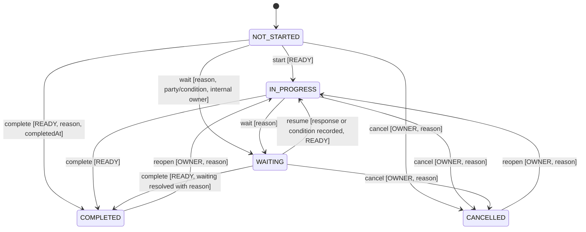

# State Machine Design — Five Axes

- Author: Claude Code (actual), claude-opus-5-5, MC-002-ARCH, packet-only.
- Inputs: requirements `572835a` / approval `54e1db5`; backend `d024e3ec9dd96abf9ada1d7516f1b2f0e8cba67b`; frontend `3e5a642479acb789eb210e73fba956f3e85082e3`.
- Status: **PROPOSED / NOT_IMPLEMENTED / WAITING_ARCHITECTURE_APPROVAL**. The approved state-semantics tables are authoritative; this document maps them to mechanisms without changing them.

## 1. Axis ownership

| Axis | Applies to | Mutable by command? | Stored? | Evaluator |
|---|---|---|---|---|
| Execution | Requirement, Action, Filing | Yes, guarded transitions | Yes | `domain/matter`, `domain/filing` |
| Verification | Requirement; Action/Filing when proof required; criterion; claim-level verdict | Never directly; only via proof events and OWNER applicability | Aggregate persisted | `engine/verification` |
| Dependency | Requirement, Action | Never | Yes (derived, same txn) | `engine/readiness` |
| Timing | Requirement, Action, Filing | Never | No; computed f(due, asOf, execution); boundary events recorded | `engine/timing` |
| Attention | Requirement, Action, Filing; Matter/Milestone roll-ups | Only OWNER escalation input | No; computed f(inputs) with reasons; boundary/derived changes recorded | `engine/attention` |

Persisting dependency and verification is a performance and auditability choice; both are recomputed in the same transaction as every causal input, so the stored value is never ahead of or behind committed inputs. Timing and attention depend on the clock, so they are computed at read with an explicit `asOf` and their *material* transitions are recorded through the boundary fence (§6), not on every refresh.

## 2. Execution transitions (Requirement/Action)



Implementation: a single table `allowedExecution map[from]map[to]Guard` in `domain/matter`. Every ordered pair not in the table returns `ErrTransitionNotAllowed{From, To, Allowed []ExecutionState}` (problem `transition-not-allowed`, 409). Same-state request with matching revision returns `200` with `noChange: true` and no event. Guards evaluated **under the matter lock** against current committed state:

| Guard | Source of truth at commit |
|---|---|
| READY | persisted `dependency_state` after boundary catch-up |
| OWNER for cancel/reopen | `matter_memberships` row read `FOR SHARE` |
| Waiting payload | request body validated; creates `waiting_on` row atomically |
| Revision | `If-Match` equals current node revision |

Side effects (same transaction): reopen sets `proof_epoch = proof_epoch + 1` (so verification becomes UNVERIFIED unless applicability is NOT_REQUIRED), clears `completed_at` into history, and triggers downstream readiness recompute. Cancel never satisfies an edge (gate requires COMPLETED). No transition creates, accepts or revokes any assessment — **completion never verifies** (AC-101, AC-121).

Corrections: `execution-corrections` command (OWNER, reason, `correctsEventSeq`) appends `node.execution_corrected` with corrected effective time or state assertion; original event untouched (AC-136). A correction that would change derived states triggers the same recompute.

## 3. Verification aggregate

Pure function, evaluated after every proof-affecting change and at boundaries:

```
aggregate(subject, asOf):
  if subject.applicability == NOT_REQUIRED: candidate = NOT_REQUIRED  (still DISPUTED if open dispute on applicable criterion — none exist by guard)
  crit = applicable mandatory criteria (current revisions) of subject
  if any open dispute on a current-epoch accepted assessment of crit: return DISPUTED
  if applicability == NOT_REQUIRED: return NOT_REQUIRED
  if len(crit) == 0: return UNVERIFIED            // no vacuous VERIFIED
  sat = criteria fully satisfied at asOf; part = criteria with ≥1 satisfied mandatory component
  if sat == crit: return VERIFIED
  if len(part) > 0 or len(sat) > 0: return PARTIALLY_VERIFIED
  return UNVERIFIED
```

Component satisfaction rules (scope, epoch, version, validity) are in [evidence-model.md §4](evidence-model.md). The aggregate is persisted with a `reasons[]` list (criterion IDs and failing conditions). Direct aggregate writes are impossible: there is no endpoint or repository method that sets `verification_state` from input (AC-127).

Applicability transitions (OWNER only): `UNVERIFIED → NOT_REQUIRED` requires zero applicable mandatory criteria, no open dispute and a reason; `NOT_REQUIRED → UNVERIFIED` happens when OWNER revokes the exemption or adds an applicable criterion (the criterion-revision command performs the revocation first, in the same transaction, and emits both events). VERIFIED/PARTIALLY_VERIFIED/DISPUTED → NOT_REQUIRED is rejected (`applicability-guard-failed`).

## 4. Dependency

READY iff every active incoming edge is satisfied; satisfied(edge u→n) = `dep(u)=READY ∧ exec(u)=COMPLETED ∧ (gate=COMPLETION ∨ ver(u)=VERIFIED)`. Recursion is through `dep(u)`. Full algorithm: [dependency-engine.md](dependency-engine.md).

## 5. Timing and attention

```
timing(node, asOf):
  if exec ∈ {COMPLETED, CANCELLED}: ON_TRACK  (+ lateness = completedAt > dueAt, shown separately)
  if dueAt == nil: ON_TRACK with flag noDueDate
  if dueAt < asOf: OVERDUE
  if asOf ≤ dueAt ≤ asOf + 48h: DUE_SOON
  else ON_TRACK

attention(node, asOf):
  reasons = []
  if node ∈ criticalChainUnsatisfied: reasons += CRITICAL_CHAIN(milestone ids)
  if node.criticalEscalation != nil: reasons += OWNER_ESCALATION(reason)
  if any CRITICAL reason: return CRITICAL, reasons + attentionReasons
  attentionReasons: OVERDUE; MISSING/EXPIRED/DISPUTED applicable proof; COMPLETED∧UNVERIFIED; WAITING
  return ATTENTION if attentionReasons else NORMAL
```

The 48-hour window is inclusive at both ends (AC-142: T and T+48h are DUE_SOON; T+48h+1s ON_TRACK; T−1s OVERDUE). OWNER escalation can add CRITICAL; nothing can remove a derived CRITICAL cause, and there is no "force NORMAL" command (AC-143). Critical-chain membership is defined in dependency-engine §5.

## 6. Boundary fence (time-driven transitions)

Time-dependent facts change without a command: proof expiry (RULE-007), due crossings (DUE_SOON/OVERDUE) and the attention changes they cause.

- Each Matter stores `next_boundary_at` = minimum future instant among: active accepted assessment `effective_until`, evidence `valid_until`, nonterminal `due_at − 48h` and `due_at`, filing due instants; and `boundaries_applied_until`.
- **Before any command or read** with `asOf ≥ next_boundary_at`, the service runs `ApplyBoundaries(matter, upTo=asOf)` inside the matter write transaction: for each boundary instant in ascending order it records events with `effective_at = boundary instant`, `recorded_at = now`, actor `SYSTEM_CLOCK`, recomputes verification aggregates and downstream readiness, and advances the fence.
- A boundary trigger (ADR-001 dependent) calls the same operation for idle matters so history reflects expiry promptly even if nobody reads; correctness does not depend on it.
- If boundaries cannot be applied (database unavailable or read-only), the read returns `503 unavailable` instead of pre-expiry state.

This gives "expiry cannot wait for a screen visit" (AC-126) a mechanical guarantee: no response can be produced at `asOf` without boundaries ≤ `asOf` applied.

## 7. Allowed combinations

All combinations of independent axes are representable; the following are explicitly expected and tested: COMPLETED+UNVERIFIED (AC-121), WAITING+READY (AC-104), WAITING+BLOCKED, IN_PROGRESS+BLOCKED and COMPLETED+BLOCKED after upstream reopen (AC-124), IN_PROGRESS+VERIFIED (allowed; proof gate still needs COMPLETED). Prohibited: new completion while BLOCKED; any client-set derived value.

## 8. Tests

| Test suite | Cases | AC |
|---|---|---|
| Execution table conformance | Every allowed row with guards true; each guard false; wrong role; stale revision; every unlisted ordered pair (5×5) | AC-160, AC-122 |
| Verification precedence | Generated criteria/claim/assessment fixtures; zero-criteria; partial components; dispute precedence; applicability sequence | AC-127, AC-157, AC-160 |
| Timing boundaries | T−1s, T, T+48h, T+48h+1s, none, terminal late; same instant in two zones | AC-142, AC-152 |
| Attention precedence | Critical chain + overdue; remove critical; escalation add/remove; no manual NORMAL | AC-143 |
| Boundary fence | Read at `valid_until`−1µs vs `valid_until` with no background trigger; history effective vs recorded time | AC-126 |
| Derived override rejection | API attempts to set dependency/verification/timing/attention fields → 422 unknown/forbidden field | AC-160 |
