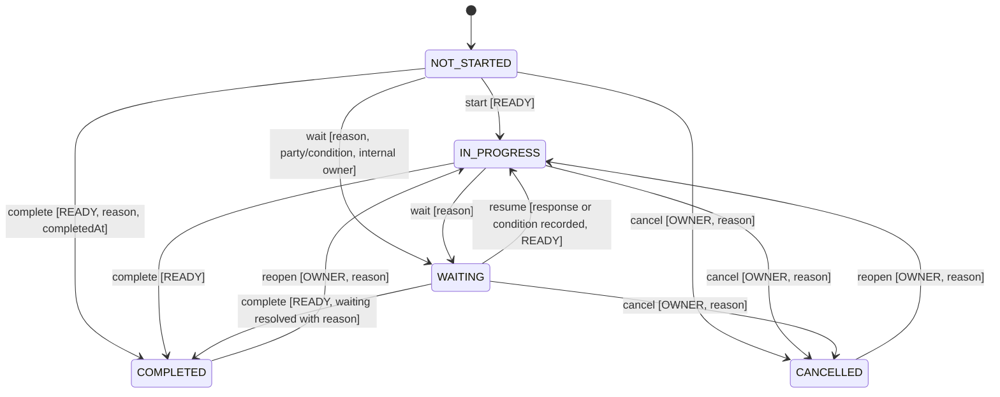

# State Machine Design — Five Axes

- Author: Claude Code (actual), claude-opus-5-5, MC-002-ARCH, packet-only.
- Inputs: requirements `572835a` / approval `54e1db5`; backend `d024e3ec9dd96abf9ada1d7516f1b2f0e8cba67b`; frontend `3e5a642479acb789eb210e73fba956f3e85082e3`.
- Status: **PROPOSED / NOT_IMPLEMENTED / WAITING_ARCHITECTURE_APPROVAL**. The approved state-semantics tables are authoritative; this document maps them to mechanisms without changing them.

## 1. Axis ownership

| Axis | Applies to | Mutable by command? | Stored? | Evaluator |
|---|---|---|---|---|
| Execution | Requirement, Action, Filing | Yes, guarded transitions | Yes | `domain/matter`, `domain/filing` |
| Verification | Requirement; Action/Filing when proof required; criterion; claim-level verdict | Never directly; only via proof events and OWNER applicability | Aggregate persisted | `engine/verification` |
| Dependency | Requirement, Action | Never | Yes (derived, same txn) | `engine/readiness` |
| Timing | Requirement, Action, Filing | Never | No; computed f(due, asOf, execution); boundary events recorded | `engine/timing` |
| Attention | Requirement, Action, Filing; Matter/Milestone roll-ups | Only OWNER escalation input | No; computed f(inputs) with reasons; boundary/derived changes recorded | `engine/attention` |

Persisting dependency and verification is a performance and auditability choice; both are recomputed in the same transaction as every causal input, so the stored value is never ahead of or behind committed inputs at its materialization instant; a response uses it only inside its validity interval (§6.2), otherwise it evaluates purely. Timing and attention depend on the clock, so they are computed at read with an explicit `asOf` and their *material* transitions are recorded through boundary materialization (§6), not on every refresh.

## 2. Execution transitions (Requirement/Action)



Implementation: a single table `allowedExecution map[from]map[to]Guard` in `domain/matter`. Every ordered pair not in the table returns `ErrTransitionNotAllowed{From, To, Allowed []ExecutionState}` (problem `transition-not-allowed`, 409). Same-state request with matching revision returns `200` with `noChange: true` and no event. Guards evaluated **under the matter lock** against current committed state:

| Guard | Source of truth at commit |
|---|---|
| READY | persisted `dependency_state` after boundary catch-up |
| OWNER for cancel/reopen | `matter_memberships` row read `FOR SHARE` |
| Waiting payload | request body validated; creates `waiting_on` row atomically |
| Revision | `If-Match` equals current node revision |

Side effects (same transaction): reopen sets `proof_epoch = proof_epoch + 1`, `proof_epoch_opened_at = t_cmd` and emits `subject.proof_epoch_advanced` (earlier-epoch assessments stop counting; verification becomes UNVERIFIED unless applicability is NOT_REQUIRED), clears `completed_at` into history, and triggers downstream readiness recompute. Filing reopen applies the same epoch rule (filing-model §4). Cancel never satisfies an edge (gate requires COMPLETED). No transition creates, accepts or revokes any assessment — **completion never verifies** (AC-101, AC-121).

Corrections: `execution-corrections` command (OWNER, reason, `correctsEventSeq`) appends `node.execution_corrected` with corrected effective time or state assertion; original event untouched (AC-136). A corrected effective time must be ≤ the correction's own `t_cmd`; future-effective assertions → `422 validation` (matches `CHECK (effective_at <= recorded_at)`). A correction that would change derived states triggers the same recompute.

## 3. Verification aggregate

Pure function, evaluated after every proof-affecting change and at boundaries:

```
aggregate(subject, asOf):
  if subject is an Action/Filing with proof_required = false: return NOT_APPLICABLE   // axis absent; not NOT_REQUIRED
  crit = applicable mandatory criteria (current revisions) of subject
  if any open dispute on the current (non-superseded, non-revoked) ACCEPTED assessment, current epoch, of a claim on c ∈ crit: return DISPUTED
  if applicability == NOT_REQUIRED: return NOT_REQUIRED
  if len(crit) == 0: return UNVERIFIED            // no vacuous VERIFIED
  sat = criteria fully satisfied at asOf; part = criteria with ≥1 satisfied mandatory component
  if sat == crit: return VERIFIED
  if len(part) > 0 or len(sat) > 0: return PARTIALLY_VERIFIED
  return UNVERIFIED
```

Component satisfaction rules (scope, epoch, version, validity) are in [evidence-model.md §4](evidence-model.md). The aggregate is persisted with a `reasons[]` list (criterion IDs and failing conditions). Direct aggregate writes are impossible: there is no endpoint or repository method that sets `verification_state` from input (AC-127).

Applicability transitions (OWNER only): `UNVERIFIED → NOT_REQUIRED` requires zero applicable mandatory criteria, no open dispute and a reason; `NOT_REQUIRED → UNVERIFIED` happens when OWNER revokes the exemption or adds an applicable criterion (the criterion-revision command performs the revocation first, in the same transaction, and emits both events). VERIFIED/PARTIALLY_VERIFIED/DISPUTED → NOT_REQUIRED is rejected (`applicability-guard-failed`).

## 4. Dependency

READY iff every active incoming edge is satisfied; satisfied(edge u→n) = `dep(u)=READY ∧ exec(u)=COMPLETED ∧ (gate=COMPLETION ∨ ver(u)=VERIFIED)`. Recursion is through `dep(u)`. `ver(u) = NOT_REQUIRED` never satisfies a proof gate (RULE-003 names VERIFIED only); the order-independent fail-closed handling is in dependency-engine §2. Milestone readiness (RULE-008) is a separate predicate that accepts NOT_REQUIRED. Full algorithm: [dependency-engine.md](dependency-engine.md).

## 5. Timing and attention

```
timing(node, asOf):
  if exec ∈ {COMPLETED, CANCELLED}: ON_TRACK  (+ lateness = completedAt > dueAt, shown separately)
  if dueAt == nil: ON_TRACK with flag noDueDate
  if dueAt < asOf: OVERDUE
  if asOf ≤ dueAt ≤ asOf + 48h: DUE_SOON
  else ON_TRACK

attention(node, asOf):
  reasons = []
  if node ∈ criticalChainUnsatisfied: reasons += CRITICAL_CHAIN(milestone ids)
  if node.criticalEscalation != nil: reasons += OWNER_ESCALATION(reason)
  if any CRITICAL reason: return CRITICAL, reasons + attentionReasons
  attentionReasons: OVERDUE; MISSING/EXPIRED/DISPUTED applicable proof; COMPLETED∧UNVERIFIED; WAITING
  return ATTENTION if attentionReasons else NORMAL
```

The 48-hour window is inclusive at both ends (AC-142: T and T+48h are DUE_SOON; T+48h+1s ON_TRACK; T−1s OVERDUE). OWNER escalation can add CRITICAL; nothing can remove a derived CRITICAL cause, and there is no "force NORMAL" command (AC-143). Critical-chain membership is defined in dependency-engine §5.

## 6. Time: clock capture, pure evaluation, boundary materialization

Time changes facts without a command: validity start/expiry (RULE-007), due crossings (RULE-009) and the verification, readiness, milestone and attention changes they cause.

**6.1 Clock capture.** One `Clock` port; production reads the database clock (`clock_timestamp()`, µs) inside the transaction, so all app instances share one time source; tests inject time (NFR-012).
- Read: `asOf` is read in the first statement of the REPEATABLE READ READ ONLY snapshot together with `matters.event_seq` (`sourceRevision`). Current-state views reject a client `asOf`; historical state is available only via the brief fold (data-model §8).
- Command: after the matter lock, `t_cmd = greatest(clock, matters.last_recorded_at)` captured once; guards, catch-up, `recorded_at` and default `effective_at` all use it. Per-matter monotonic even if the clock steps back.

**6.2 Pure evaluation.** Timing, attention, component validity, verification aggregate, readiness, milestone readiness and critical-chain membership are functions of (committed inputs, instant). A response equals f(inputs visible in its snapshot, `asOf`). Stored derived values are a materialization valid on `[boundaries_applied_until, next_boundary_at)`; a read uses them only if `asOf` lies in that interval, otherwise it recomputes in memory from the snapshot. Reads never write or lock, so expiry takes effect at its instant for every read even if no write or worker ran (AC-126).

**6.3 Boundary set** (instants > `boundaries_applied_until`; `next_boundary_at` = minimum or NULL):

| Source | Instant | Population |
|---|---|---|
| Due-soon start | `due_at − 48h` | nonterminal Requirement/Action/Filing with due |
| Overdue start | `due_at + 1µs` (first instant with `due_at < asOf`; at `asOf = due_at` the state is DUE_SOON) | nonterminal |
| Validity start | future `evidence.valid_from` | non-withdrawn evidence with a current, non-revoked, current-epoch ACCEPTED assessment, **in any subject execution state** (incl. COMPLETED/CANCELLED Requirement/Action, approved/completed Filing) |
| Validity end | `min(valid_until, effective_until)` (half-open) | same |

The *nonterminal* qualifier applies only to the two due rows (RULE-009: terminal → ON_TRACK). Validity rows are not filtered by execution: a COMPLETED Requirement/Action or approved/completed Filing whose accepted proof reaches its validity end loses satisfaction at that instant, and its verification, proof-gated downstream readiness, milestone readiness and attention change (RULE-007, AC-126). Pure reads (§6.2), materialization (§6.4) and `next_boundary_at` use this same population. `next_boundary_at` is recomputed from scratch after any write touching a contributing input.

**6.4 Materialization.** `ApplyBoundaries(matter, upTo)` runs only inside a matter write transaction: every command with `upTo = t_cmd` before its own logic, and the boundary worker with its own `t_cmd` (selected via index on `next_boundary_at`). For each distinct instant b in `(boundaries_applied_until, upTo]` ascending, all inputs at b are processed together and recomputed. Material events (`assessment.expired`, `node.timing_boundary_crossed`, derived changes) get `effective_at = b`, `recorded_at = t_cmd`, actor `SYSTEM_CLOCK`, ordered by (b, kind, target ID). Then `boundaries_applied_until = upTo`. Idempotent: retries/concurrent workers serialize on the lock and find nothing left.

**6.5 Linearization (explicit).** A command is linearized at `t_cmd`. If a boundary b falls in (t_cmd, commit), the command still commits as of `t_cmd`, and b is materialized by the next write/worker; reads at `asOf ≥ b` already reflect b via 6.2. A read is linearized at its snapshot: it reflects exactly the commits visible there (named by `sourceRevision`) evaluated at `asOf`, and does not claim to include every event with `recorded_at ≤ asOf`. Nothing is claimed atomic with respect to wall-clock crossing.

**6.6 Late recording.** Without writes or the worker, boundary events are recorded late (`recorded_at > effective_at`); history shows both. Responses carry `historyMaterializedThrough`; lag never changes the returned state.

**6.7 Unavailable.** `503` if the database or snapshot fails or the engine detects an invariant violation (e.g., node without typed row, missing current criterion revision). A command whose catch-up fails aborts entirely and is retryable with the same Idempotency-Key. Lag alone is not unavailability.

## 7. Allowed combinations

All combinations of independent axes are representable; the following are explicitly expected and tested: COMPLETED+UNVERIFIED (AC-121), WAITING+READY (AC-104), WAITING+BLOCKED, IN_PROGRESS+BLOCKED and COMPLETED+BLOCKED after upstream reopen (AC-124), IN_PROGRESS+VERIFIED (allowed; proof gate still needs COMPLETED). Prohibited: new completion while BLOCKED; any client-set derived value.

## 8. Tests

| Test suite | Cases | AC |
|---|---|---|
| Execution table conformance | Every allowed row with guards true; each guard false; wrong role; stale revision; every unlisted ordered pair (5×5) | AC-160, AC-122 |
| Verification precedence | Generated criteria/claim/assessment fixtures; zero-criteria; partial components; dispute precedence; applicability sequence | AC-127, AC-157, AC-160 |
| Timing boundaries | T−1s, T, T+48h, T+48h+1s, none, terminal late; same instant in two zones | AC-142, AC-152 |
| Attention precedence | Critical chain + overdue; remove critical; escalation add/remove; no manual NORMAL | AC-143 |
| Boundary materialization | Reads at `valid_until`−1µs/`valid_until`, `due_at`/`due_at`+1µs and future `valid_from` with no worker and no write: state correct and read issues no write; later write materializes events (`effective_at` = boundary, `recorded_at` = `t_cmd`); clock injected between lock and commit (linearization at `t_cmd`); COMPLETED+VERIFIED upstream (and an approved Filing) whose sole accepted proof reaches `valid_until`: execution unchanged, verification UNVERIFIED, proof-gated downstream BLOCKED, milestone not ready, EXPIRED attention reason, instant present in `next_boundary_at` | AC-126, AC-142, AC-102 |
| Derived override rejection | API attempts to set dependency/verification/timing/attention fields → 422 unknown/forbidden field | AC-160 |
