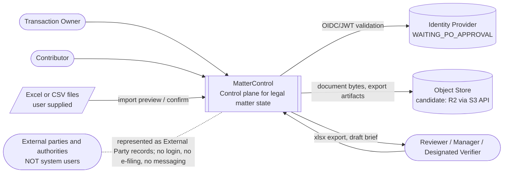
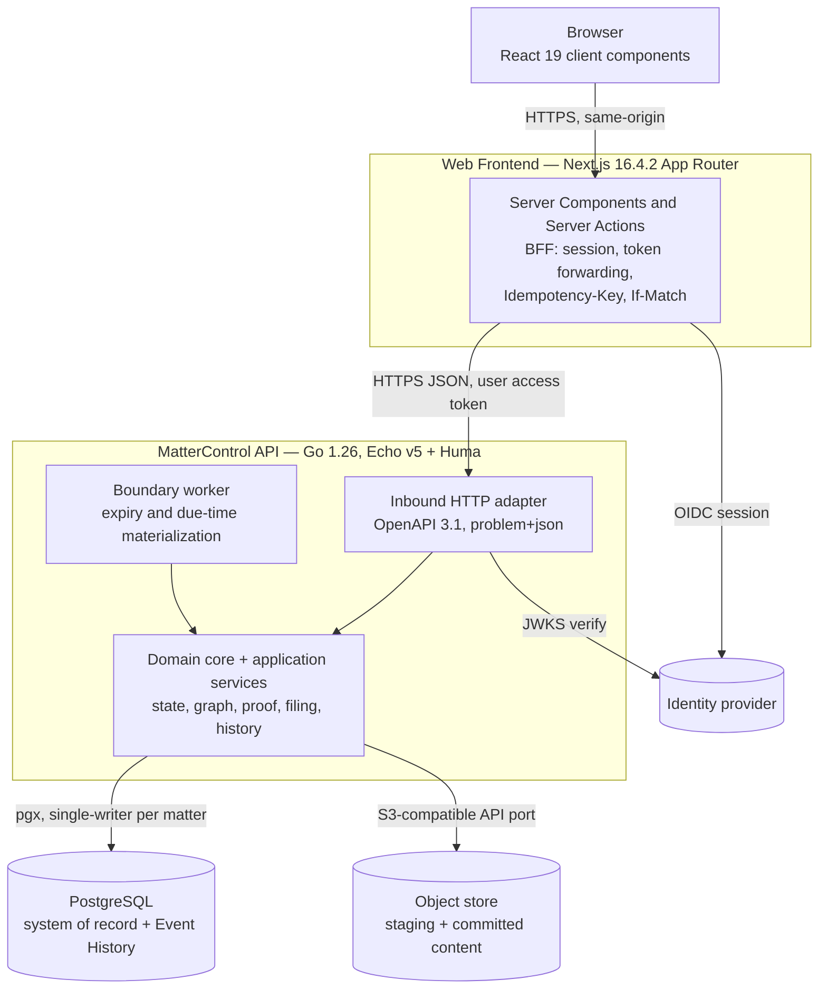
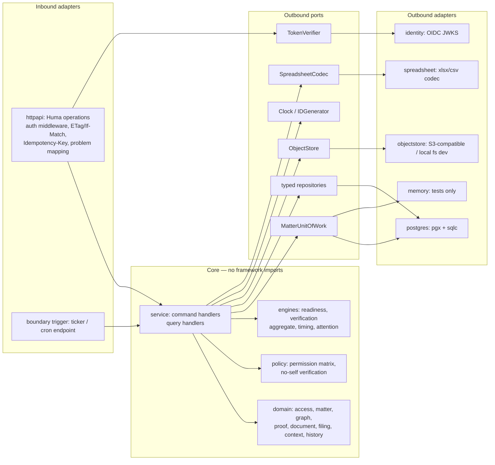

# MatterControl — System Architecture

- Author: Claude Code (actual), model claude-opus-5-5, task MC-002-ARCH. Packet-only execution: no tools, no filesystem access, no commands, no PoC.
- Inputs: requirements subject `572835a21bda764901a11aaea3c06b88750b2883`, approval record commit `54e1db5`; backend template `d024e3ec9dd96abf9ada1d7516f1b2f0e8cba67b`; frontend template `3e5a642479acb789eb210e73fba956f3e85082e3`; Cloudflare documentation snapshots supplied by Codex (dated Apr–Oct 2026).
- Status: **PROPOSED / NOT_IMPLEMENTED / WAITING_ARCHITECTURE_APPROVAL**. Hosting, frontend adapter, identity provider, object store and workload values are **WAITING_PO_APPROVAL**. Critical blockers in [technical-blockers.md](technical-blockers.md) are **OPEN**.
- Rework: MC-002-ARCH-REWORK round 1 applied after OpenCode round 1 (CHANGES_REQUIRED); index in [step-02-claude-architecture-result.md §7](../reviews/step-02-claude-architecture-result.md). Not yet re-reviewed; no PASS claimed.

## 1. Scope

This document is the entry point for the logical candidate architecture. It is hosting-neutral: every component below can run under any topology in [ADR-001](adr/ADR-001-runtime-and-hosting.md), and none of them assumes the Go server runs unchanged on Cloudflare Workers. Companion documents:

| Concern | Document |
|---|---|
| Typed domain, aggregates, P1 extension points | [domain-model.md](domain-model.md) |
| Five state axes, guards, derived-state evaluation | [state-machine.md](state-machine.md) |
| Dependency graph, recursive READY, cycle prevention | [dependency-engine.md](dependency-engine.md) |
| Criteria, evidence, scoped assessments, disputes, expiry | [evidence-model.md](evidence-model.md) |
| Document identity, versions, promotion, content storage | [document-lineage.md](document-lineage.md) |
| Filing stages, cycles, submissions, negative outcomes | [filing-model.md](filing-model.md) |
| HTTP contracts | [api-contracts.md](api-contracts.md) |
| PostgreSQL schema, constraints, transactions, read snapshots | [data-model.md](data-model.md) |
| Identity, authorization, threats | [security-architecture.md](security-architecture.md) |
| Runtime/hosting, concurrency, frontend adapter decisions | ADR-001 / ADR-002 / ADR-003 |

## 2. Architecture drivers

1. **Operational truth over task tracking.** Requirement ≠ Action, criterion ≠ proof, completion ≠ verification, waiting ≠ blocked (RULE-001/002). Each concept is a typed aggregate; there is no generic Item + JSON metadata model.
2. **Server-side authority for state.** All five axes are evaluated in the Go domain core. The frontend renders returned states and reasons; it never derives READY/VERIFIED (RULE-002, NFR-013).
3. **Synchronous causal consistency.** An accepted command and every derived consequence (dependency, verification aggregate, milestone readiness, critical chain, history) commit in one transaction. Revocation and reopen are never "eventually" applied. Expiry and due crossings are evaluated purely at each response's server-captured `asOf`, so no read or command observes a state contradicting the committed inputs visible to it at that instant; boundary history is materialized by the next write or the boundary worker (RULE-004/007/018; [state-machine §6](state-machine.md)).
4. **Attributable, append-only history** written in the same transaction as the mutation (RULE-019, FR-008).
5. **Matter-scoped isolation**: active Workspace membership AND explicit Matter membership AND operation permission on every path, including files, exports and history (RULE-017).
6. **Preserve source architecture**: Go hexagonal ports/adapters (template `internal/core/{domain,port,service}`, `internal/adapter/...`), Huma/OpenAPI 3.1, RFC 9457 problems, sqlc + Goose, version CAS; Next.js Atomic Design + feature modules with repository services and Server Actions.
7. **Cost constraint**: Cloudflare Free Tier, $0/month for an approved workload — currently unresolved for the Go/PostgreSQL stack (TB-01/02).

## 3. System context



External parties, signatories and authorities are records, not integrations. MatterControl does not send email, sign, pay, transfer or file (PRD §16).

## 4. Container view (logical, hosting-neutral)



| Container | Responsibility | Source basis | Hosting status |
|---|---|---|---|
| Web Frontend | Rendering, navigation, drafts, BFF calls; no domain authority | Next 16.4.2, Server Actions, `src/lib/api/backend.ts` | ADR-003 unresolved |
| MatterControl API | All commands, queries, authorization, derived state, history | Echo v5/Huma, fx lifecycle, net/http TCP listener (`internal/app/app.go`) | ADR-001 unresolved; NOT runnable unchanged in Workers |
| Boundary worker | Materializes due/expiry boundary history and stored derived values for idle matters; read correctness does not depend on it (pure evaluation at `asOf`) | New; in-process ticker or external trigger | Depends on ADR-001 |
| PostgreSQL | System of record, constraints, append-only history, idempotency receipts | pgx v5, Goose, sqlc | Provider unresolved (TB-02); no D1 substitution |
| Object store | Immutable document version bytes, import sources, export artifacts | New outbound port | R2 candidate (TB-05) |
| Identity provider | Authentication only; authorization stays in MatterControl | Template has none | WAITING_PO_APPROVAL (TB-04) |

Not included by default: Kafka/relay (`EVENTS_SINK=none` stays), generic workflow engine, KV as source of truth (KV is eventually consistent per Cloudflare docs and unsuitable for authority), D1.

## 5. Backend component view (hexagonal)



Proposed package layout (extends template, keeps depguard dependency rule):

```
internal/core/domain/{access,matter,graph,proof,document,filing,context,history}
internal/core/engine/{readiness,verification,timing,attention}   // pure functions, clock injected
internal/core/policy/                                             // matrix-driven Can(actor, op, scope)
internal/core/port/        // inbound use-case interfaces, outbound ports, ErrNotFound, ErrVersionConflict
internal/core/service/     // command/query handlers; one MatterUnitOfWork per command
internal/adapter/inbound/httpapi/
internal/adapter/outbound/{postgres,memory,objectstore,identity,spreadsheet,system}
internal/adapter/outbound/repotest/   // shared contract suite, including concurrency contracts
```

The central outbound port is `MatterUnitOfWork.Execute(ctx, matterID, func(tx MatterTx) error)`: it serializes all writes for one Matter, provides the matter event sequence, and guarantees that mutations, derived updates, history and idempotency receipt commit atomically ([ADR-002](adr/ADR-002-transaction-and-concurrency.md)). The memory adapter implements it with a per-matter mutex so the contract suite can run without PostgreSQL; it is never a production storage option.

## 6. Frontend component view (Atomic Design + features)

| Layer | Content | Rule |
|---|---|---|
| `components/atoms` | `StateLabel` (text + icon, never color-only), `RevisionTag`, `AsOfStamp`, existing Button/Input/Select | No domain imports |
| `components/molecules` | `ReasonList`, `FieldErrorSummary`, `ConflictNotice`, `UnavailableNotice` | Distinguishes loading / error / stale / empty (AC-156) |
| `components/organisms` | `KeyboardGrid` (generic, row-ID focus, multiselect), `TimelineList`, `DataTable` | Presentational only |
| `components/templates` | `DashboardTemplate`, `MatterTemplate` (matter switcher, contextual navigation) | Layout slots |
| `features/*` | `control-room`, `operational-grid`, `my-actions`, `dependencies`, `evidence`, `documents`, `filings`, `history`, `status-brief`, `import-export`, `access` | Each owns `schemas.ts` (Zod mirrors of OpenAPI), `services/` (REST repository), `actions.ts` (Server Actions), `components/` |
| `lib/api` | `backendRequest` extended with `Idempotency-Key`, `If-Match`, problem parsing | Shared `API_TOKEN` fallback removed for MatterControl data (TB-04) |

Demo repositories may remain for Storybook fixtures only; production builds must fail if `API_MODE=demo` (TB-12).

## 7. Domain boundaries

| Bounded context | Aggregates / records | Owns invariants |
|---|---|---|
| Access | Workspace, WorkspaceMembership, MatterMembership, VerifierDesignation | RULE-017, last-owner, no self-grant |
| Matter operations | Matter, Workstream, Milestone(+prerequisites), Requirement, Action, RequirementActionLink, WaitingOn | Execution guards, milestone readiness, Next Action ordering |
| Graph | DependencyEdge (within Matter) | AND gates, recursive READY, acyclicity |
| Proof | EvidenceRequirement(+revisions, components), Evidence, EvidenceClaim, EvidenceAssessment, Dispute, ApplicabilityDecision | RULE-005/006/007, scoped acceptance, no-self |
| Documents | Document, DocumentVersion, ContentObject, SignatureObservation | RULE-011, explicit promotion |
| Filing | Filing, FilingCycle, StageObservation, Submission(+items) | RULE-012 stage guards |
| Legal context (basic P0) | ExternalParty, EntityReference, Decision, Finding, Risk | RULE-020; Legal Question reserved for P1 |
| History | DomainEvent, SecurityAuditEvent, CommandReceipt | RULE-018/019 |
| Reporting & IO | StatusBrief generation, ExportArtifact, ImportBatch, BulkOperation | RULE-013/014/015/016 |

The Matter is the **consistency boundary**: graph, proof and state propagation never cross Matters (cross-matter links are not approved), so serializing writes per Matter is both sufficient and simple.

## 8. Consistency model summary

- Writes: per-Matter serialized transaction in the global lock order ([ADR-002 §1a](adr/ADR-002-transaction-and-concurrency.md)): matter row `FOR UPDATE`; command instant `t_cmd = greatest(database clock, last_recorded_at)` captured once; boundary catch-up to `t_cmd`; authorization with membership rows `FOR SHARE`; idempotency replay check; record CAS; derived recompute; events with strictly increasing `seq` and `recorded_at = t_cmd`; receipt — one commit, linearized at `t_cmd`.
- Reads: one `REPEATABLE READ READ ONLY` snapshot; `asOf` (database clock) and `sourceRevision` captured in its first statement; current-state views never accept a client `asOf`. Time-derived values are evaluated purely at `asOf`; stored derived values are used only inside their validity interval. Reads never write.
- Time: boundary instants (due−48h, due+1µs, future `valid_from`, validity end) are materialized as history by the next write or the boundary worker with `effective_at` = boundary and `recorded_at` = materialization instant ([state-machine §6](state-machine.md)). Expiry is reflected at its instant in every response even before materialization; late-recorded history says so.
- Failure: `503 unavailable` if the database is unreachable, a snapshot/command fails, a deadlock is detected, or the engine detects an invariant violation; never a default READY/VERIFIED/zero. Materialization lag is reported (`historyMaterializedThrough`), not turned into unavailability.

## 9. Integration architecture

| Integration | Port | Candidate adapter | Notes |
|---|---|---|---|
| Identity | `TokenVerifier` | OIDC/JWT with JWKS cache | Provider WAITING_PO_APPROVAL; authentication only |
| Object store | `ObjectStore` (PutIntent, Head, Get stream, Delete) | S3-compatible (R2 candidate); local filesystem for development | Staging/commit/reconcile protocol in document-lineage.md |
| Spreadsheet | `SpreadsheetCodec` | Go xlsx/csv library to be selected and audited by ZCode | Never evaluates formulas/macros, never fetches links |
| Clock / IDs | `Clock`, `IDGenerator` | Template `system.Clock` (UTC, µs), UUIDv7 | Tests inject time (NFR-012) |
| Telemetry | OpenTelemetry (template) | OTLP endpoint optional | No parameter values, no document content in spans/logs |
| Events to other systems | none in P0 | template outbox stays disabled | Domain history is not a broker stream |

## 10. Invariant ownership matrix (Step 02 §6)

| # | Invariant | Owning component | Mechanism | Primary tests |
|---|---|---|---|---|
| 1 | Execution state | domain/matter | Transition table + guards in core | AC-160, AC-122 |
| 2 | Verification state | engine/verification | Derived aggregate, precedence rules | AC-127, AC-157, AC-160 |
| 3 | Dependency state | engine/readiness | Recursive AND over DAG | AC-105, AC-124 |
| 4 | Timing state | engine/timing | Pure f(due, asOf, execution) + boundary materialization (state-machine §6) | AC-142 |
| 5 | Attention state | engine/attention | Pure f(inputs) with reasons; escalation record | AC-143 |
| 6 | Dependency satisfaction | engine/readiness | Gate kinds COMPLETION / COMPLETION_AND_VERIFIED | AC-105, AC-123 |
| 7 | Blocker propagation | service + readiness | Topological recompute of downstream closure in same txn | AC-124, AC-146 |
| 8 | Cycle prevention | domain/graph + UoW | Reachability check under matter lock; DB self-edge/unique constraints; typed-node totality trigger | AC-125 |
| 9 | Evidence lifecycle | domain/proof | Claims, canonical current assessment per (claim, epoch), revoke, dispute, proof epochs for Requirement/Action/Filing | AC-107, AC-126, AC-157 |
| 10 | Criterion↔Evidence M:N | domain/proof | `evidence_claims` + per-claim assessments; no global evidence verdict | AC-127, evidence-model tests EV-01..06 |
| 11 | Version lineage | domain/document | Immutable versions, single current pointer, explicit promotion | AC-115, AC-128 |
| 12 | Filing lifecycle | domain/filing | Stage table, cycles, immutable submissions, reopen advances proof epoch | AC-116, AC-129, AC-145 |
| 13 | History consistency | MatterUnitOfWork | Events in same txn; append-only table | AC-108, AC-149, AC-153 |
| 14 | Deterministic brief | service/reporting | Recorded-time window over event sequence; bitemporal reconstruction | AC-119, AC-138 |
| 15 | Bulk operations | service/bulk | Preview bound to actor/matter/expiry/digest; per-row txn with recorded row outcome (api-contracts §3.6) | AC-112, AC-133 |
| 16 | Import/export | service/io | One matter-locked all-or-nothing txn per connected group, row-key idempotency, formula-safe codec (api-contracts §3.7) | AC-113, AC-131, AC-132, AC-148 |
| 17 | Authorization | policy + UoW | Matrix in core, checked inside txn with FOR SHARE | AC-118, AC-134, AC-135, AC-147 |
| 18 | Concurrent updates | UoW + CAS | Global lock order (ADR-002 §1a) + revision CAS + receipts | AC-139, AC-125 |
| 19 | Auditability | history | Actor, before/after, effective/recorded, cause, correlation | AC-108, AC-136 |
| 20 | P1/P2 extension | domain packages | Reserved types and expand-only migrations | domain-model §9 |
| 21 | GW-01 end-to-end | services across matter, proof, document, filing, reporting | Workflow suite at the HTTP seam (`httpapi` + real PostgreSQL + injected Clock) driving the stage checkpoint ledger: command → Grid, Control Room, `events`, brief readback at one `sourceRevision`; reopen of verified upstream after closing exposes dependents, closing observation kept | AC-161 + AC-102/107/115/121/123/124/128/140/141 |
| 22 | GW-02 end-to-end | proof + legal context + waiting | Same seam: gap → finding → follow-up → wait/response → resolution proof per criterion/version; wrong-matter response rejected (composite FKs, uniform 404) | AC-162 + AC-101/106/126/127/130/140/157/159 |
| 23 | GW-03 end-to-end | domain/filing + proof + documents | Same seam: two supplement cycles, no-supplement, incomplete package, rejection, reopen epoch | AC-163 + AC-116/129/130/145/147 |

Rows 21–23 name owners and seams only; suites are NOT_RUN; execution owners (ZCode/OpenCode) assigned by Codex.

## 11. NFR mapping

| NFR | Architectural response | Remaining gate |
|---|---|---|
| NFR-001/002 | In-transaction authorization, uniform 404, proxy-only content retrieval, no shared service token for user data | Identity provider, threat review by OpenCode |
| NFR-003/009 | Receipts only in the command txn; replay and operations lookup re-authorized; same-key resubmission; per-row/per-group outcome records | Receipt retention value; DB-enforced command deadline (TB-13) |
| NFR-004 | Append-only `domain_events`, separate restricted `security_audit_events` | Retention/legal hold policy (OBD-11) |
| NFR-005 | DB constraints (composite same-matter FKs, unique edges, CHECK no-self), CAS, matter lock | Concurrency tests |
| NFR-006 | Per-matter read models sized for 50–200-row views; keyset pagination | Budgets unapproved; AC-154 measurement NOT_RUN |
| NFR-007/010/011 | Text state labels, ISO-8601 instants with offset, explicit zone in every view/export | OpenDesign Step 03 |
| NFR-008 | 503 `unavailable` problems; UI distinguishes stale/error/empty | Availability objective unapproved |
| NFR-012/013 | Pure engines with injected clock; invariant owner per row above | — |
| NFR-014 | Logical dumps/PITR + object versioning options | RPO/RTO unapproved (§12) |

## 12. Workload, retention and recovery options — NOT_APPROVED

The PO deferred these numbers to Step 02. The following are **options for decision**, not approved values, SLAs or measurements.

| Option | Workspaces | Active matters | Named users | Peak concurrent editors | Records per matter | Stored content | Import/export |
|---|---|---|---|---|---|---|---|
| W1 Pilot | 1 | ≤ 10 | ≤ 15 | ≤ 5 | ≤ 300 | ≤ 2 GB, files ≤ 25 MiB | a few per week |
| W2 Small team | ≤ 3 | ≤ 50 | ≤ 50 | ≤ 15 | ≤ 1,000 | ≤ 10 GB | daily |
| W3 Growth | > 3 | > 50 | > 50 | > 15 | > 1,000 | > 10 GB | frequent |

Illustrative arithmetic only (not measurement, not a capacity claim): W1 at roughly 400 API requests per user-day is about 6,000 requests/day; W2 about 20,000. Against the documented Workers Free 100,000 requests/day this holds only if every dynamic request (SSR, Server Actions, API, retries, worker invocations, other Workers on the account) is counted. Hyperdrive Free counts **database statements** (100,000/day per supplied snapshot), not requests, and applies only if a Worker reaches PostgreSQL through Hyperdrive (not an H1 Go origin connecting directly). Required check: Σ(requests per type × measured statements per request) + worker transactions × statements + retries ≤ 100,000/day with approved headroom. One command (data-model §7) is roughly 10–15 statements; one view snapshot roughly 5 or more. W2 at 20,000 × 5 = 100,000 is already at the limit, so Hyperdrive headroom is **NOT_SHOWN** for W2 and unmeasured for W1 (AC-154). Reads no longer write (state-machine §6). W2 storage approaches the documented R2 free 10 GB-month allowance. W3 is expected to exceed free allowances.

| Topic | Options for PO | Consequence |
|---|---|---|
| Retention | R-A: retain all history and versions for matter lifetime until an explicit disposition policy exists; R-B: fixed period after matter closure (value to approve) with legal-hold override | R-A grows storage; R-B needs erasure/hold workflow (not generic delete) |
| RPO | RP-A: daily logical dump to object store; RP-B: provider point-in-time recovery if the chosen provider offers it (unverified); RP-C: continuous WAL archive | Cost and provider dependent |
| RTO | RT-A: manual restore runbook rehearsed in isolated environment; RT-B: warm standby | RT-B unlikely to be $0 |
| Object recovery | Bucket object versioning or periodic copy, with DB/object reconciliation after restore | Must restore links consistently (AC-155) |

## 13. Architecture risk assessment

| Risk | Likelihood / impact | Mitigation | Status |
|---|---|---|---|
| Go/PostgreSQL cannot be hosted within Cloudflare Free Tier and $0 | High / Critical | ADR-001 options; PO decision; no silent substitution | OPEN (TB-01/02) |
| Next.js 16.4.2 features incompatible or CPU-heavy on Workers Free | High / High | ADR-003 options; Antigravity PoC | OPEN (TB-03) |
| No authentication in either template | Certain / Critical | Security architecture; identity decision | OPEN (TB-04) |
| Per-matter write serialization limits throughput | Low at W1/W2 / Medium | Short transactions; measured lock wait | Accepted proposal, measure |
| Event-fold reconstruction for briefs becomes slow | Low / Medium | Rebuildable internal checkpoints (not P1 snapshots) | Monitor |
| Retention policy conflicts with brief reproducibility | Medium / High | Fail honestly when inputs purged; PO policy | OPEN (TB-06) |
| Owner audits (ZCode, Antigravity) not executed | Certain / High | Explicit handoffs; findings here are source interpretation only | OPEN (TB-10) |
| Last-effective-OWNER guard blocks an urgent workspace revocation | Medium / High | Fail-closed guard; transfer first; break-glass only by PO decision | OPEN (ARCH-Q4) |
| Brief sealing and receipt key-age/purge margin need a DB-enforced transaction deadline (no idempotency final-absence promise) | Medium / Medium | `transaction_timeout` or equivalent; verify in P-BE-2 | OPEN (TB-13) |

## 14. Explicit non-decisions

No hosting provider, database provider, identity provider, frontend adapter, object-store activation or paid service is selected. No Go→TypeScript or PostgreSQL→D1 migration is proposed as a default. The design is a logical candidate under declared assumptions and stops at the Architecture Approval Gate.
