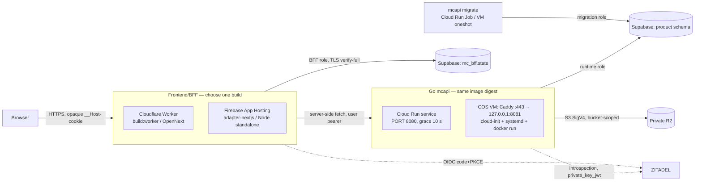

# MC-CLAUDE-DEPLOYMENT-PORTABILITY-20261030 — design and implementation plan

Author: actual Claude Code, Solution Architect. Saved before source/config edits. Assessment: `docs/testing/claude-deployment-portability-20261030-r1/assessment.md`. Base: `codex/unified-project-flow` @ `20feedbf…` + pinned dirty tree (`source-pin-before.json`).

## 1. Goal and success criteria

Same product source supports FE = {Cloudflare Workers, Firebase App Hosting} × BE = {Cloud Run, Compute Engine}, with Supabase PostgreSQL, private R2 and ZITADEL unchanged. Workers + Cloud Run stays the selected default (ADR-006).

Verifiable criteria:

1. Each FE artifact is produced by its own documented builder from the same source; the App Hosting artifact is produced by the real `@apphosting/adapter-nextjs` build path, not by renaming a Node build.
2. One backend image digest runs under a Cloud Run contract profile and a VM profile; migrations run as a separate step in both.
3. All four combinations pass the same HTTP probe set (auth, SSR, Server Action origin, forbidden/revoked, upload/download SHA, logout) against synthetic IdP + PostgreSQL + fake S3.
4. Two FE instances share durable state; restart does not lose sessions; concurrent refresh sends one refresh token to the IdP.
5. Backend drains an in-flight request on SIGTERM under both profiles.
6. Invalid/unknown profile configuration fails closed with nonsecret messages (tests).
7. Existing FE/BE gates re-run on final bytes; differences from baseline recorded.

Requirement/contract traceability (P-1…P-10 → design → verification) is in the task file `docs/implementation/tasks/MC-CLAUDE-DEPLOYMENT-PORTABILITY-20261030.md`.

## 2. Diagrams

Deployment (operator picks one FE and one BE; never both live behind one origin):



Request/state flow (identical on both FE runtimes; only the builder differs):

```mermaid
sequenceDiagram
  participant B as Browser
  participant F as BFF instance N
  participant S as mc_bff.state (PG)
  participant I as IdP
  participant A as mcapi
  B->>F: GET /api/auth/login
  F->>S: seal PKCE (AES-GCM, AAD=row key)
  F-->>B: 307 authorize + opaque login cookie
  B->>F: GET /api/auth/callback (any instance)
  F->>S: open PKCE, delete; create session (tokens sealed)
  F->>I: code + verifier → tokens
  F-->>B: 307 + opaque session cookie
  B->>F: GET /workspaces (any instance)
  F->>S: read session (idle/absolute expiry); claim refresh under xact lock if expired
  F->>A: Authorization: Bearer <user access token>
  A->>I: introspect (cache ≤ TTL)
  A-->>F: data / hidden-not-found / 401
```

## 3. Alternatives considered

| Option | Verdict |
|---|---|
| Runtime adapter interface for FE state (Worker vs Node implementations) | Rejected: the current store uses only APIs present in both runtimes; no observed difference. Re-open only if the Node+PG run fails. |
| `HOST_PROVIDER`/`DEPLOY_TARGET` env flag in app code | Rejected: builders already differ (`build:worker` vs adapter `npm run build`); env cannot make a Node artifact a Worker. |
| Docker image for App Hosting (custom `runCommand`/`buildCommand`) | Rejected: overriding opts out of the framework adapter. |
| vinext for both runtimes | Out of scope; OpenNext stays (ADR-006 evidence). |
| VM via konlet / `create-with-container` | Rejected: deprecated per current docs. |
| VM via Kubernetes/Nomad/IaC framework | Rejected: prompt forbids; one container + Caddy suffices. |
| VM TLS via external HTTPS load balancer or Cloudflare Tunnel | Recorded alternatives; LB has a standing monthly charge, Tunnel adds a Cloudflare dependency on the API path. Template uses Caddy automatic HTTPS; choice is a PO cost/security decision. |
| Go code change: read `PORT` | Rejected: explicit `MC_HTTP_ADDR` per profile is clearer and already exercised. |
| Go code change: `MC_DB_MAX_CONNS` | Deferred handoff to backend owner: current 10 × instances is bounded; needed only if the measured Supabase pool budget is < 10/instance. |
| Go code change: forbid `fs` on VM | Rejected in code (no reliable VM signal); enforced by the profile renderer instead. |

## 4. Selected minimum design

1. **FE build profiles.** Worker: unchanged. App Hosting: new `apps/frontend/apphosting.yaml` — `runConfig` bounded (min 0, max 2, concurrency 40, 1 CPU, 512 MiB); env values nonsecret and RUNTIME-only (`API_MODE=rest`, fail-closed placeholder `API_BASE_URL`, `AUTH_ALLOW_ANONYMOUS=false`, `BFF_STATE_BACKEND=postgres`, `SESSION_COOKIE_SECURE=true`); secrets `BFF_DATABASE_URL`, `BFF_STATE_KEYS` as Secret Manager references with RUNTIME availability. Per-environment values (`APP_ORIGIN`, `OIDC_*`, real `API_BASE_URL`, `BFF_STATE_KEY_ID`) go in `apphosting.<environment>.yaml` or console, documented, not committed.
2. **No FE runtime adapter** unless the integration run shows one is needed.
3. **BE deployment profiles** under `ops/deploy/`: `cloud-run/service.yaml`, `cloud-run/migrate-job.yaml`, `compute-engine/cloud-init.yaml` (COS: systemd units for secret fetch, mcapi, migrate oneshot, Caddy), `compute-engine/Caddyfile`, plus `profiles.mjs` renderer/validator: `node ops/deploy/profiles.mjs <cloud-run|compute-engine> <values.json> <out-dir>` — refuses unknown profiles, missing/placeholder values, non-https endpoints, non-`r2` object backend, inline secret values, mutable image tags; renders to a new directory; executes nothing.
4. **Docs:** ADR-007, runbook (environment/secret contract, selection, switch, rollback), cloud-validation approval packet.

## 5. File ownership and exact edits

| Path | Status | Owner check | Edit |
|---|---|---|---|
| `apps/frontend/apphosting.yaml` | new | no other writer | create |
| `apps/frontend/src/lib/mc/deploy-profiles.test.ts` | new | no other writer | invariant tests for `apphosting.yaml` + `wrangler.jsonc` |
| `ops/deploy/**` | new | no other writer | templates, renderer, `node --test` file |
| `apps/frontend/Dockerfile` | modified by others? (not in status list as modified) | stale "one instance only" comment | **no edit**; note in runbook (Docker path is not an assigned target) |
| `next.config.ts`, `package.json`, lockfile, `durable-state.ts`, backend Go | Codex/ZCode dirty work | not touched | none planned |
| `docs/architecture/adr/ADR-007-*.md` | new | — | create |
| `docs/architecture/adr/ADR-006-*.md` | historical | — | append a 1-paragraph supersession notice only |
| `docs/deployment/free-phase-deploy-checklist.md`, `README.md` | controlling docs | — | add links only |
| task, evidence dir | new | — | create |

Concurrent writer observation: Local Codex wrote its ADR-006 remediation evidence until ~10:02 +07; no source writes after the pin. Drift is re-checked before the first edit and at the end; overlapping files are not edited.

## 6. Verification plan (all local, synthetic)

Fixture (labelled `mc.owner=claude-portability-20261030`), one Docker network namespace so loopback URLs are identical for host and containers (Docker host networking is disabled here):

- `postgres:18.6-alpine` (namespace owner, publishes loopback ports), two databases: product + BFF state.
- `node:24.22.1-slim` running a synthetic OIDC issuer (authorize/token/refresh/introspect/revoke with fixture controls) and a fake S3 (HEAD/PUT/GET, checksum header verified, SigV4 header required but not validated).
- Backend image built once from the exact backend source; containers run with (a) Cloud Run contract env (`K_SERVICE`, `PORT=8080`, `MC_HTTP_ADDR=0.0.0.0:8080`, r2, read-only rootfs, tmpfs) and (b) VM profile flags rendered from the same `docker run` line as the systemd unit (read-only, `cap-drop ALL`, no-new-privileges, memory/pids limits, key file 0400).
- FE A: isolated exact copy → frozen install → `pnpm build:worker` → `wrangler dev --local`.
- FE B: isolated exact copy → frozen install → `apphosting-adapter-nextjs-build` (14.0.22, scratch tool dir) → `node .next/standalone/server.js` ×2 instances.
- Probe harness (adapted from Codex's `mc-worker-smoke-final.mjs`, parametrised): root redirect, anonymous session, PKCE redirect, callback after FE restart, session on second instance, SSR from Go/PG, CSS, 1 MiB + 26,213,376 B upload/download SHA through fake S3, Server Action foreign-origin refusal + same-origin write/readback, second user forbidden/hidden, revoked user denied, concurrent refresh (one refresh-grant per generation), logout refused on the other instance, origin change → controlled relogin.
- Backend SIGTERM with an in-flight slow upload on both profiles.
- A→B→A build in one copy: profile markers + `next.config.ts` hash restored + no secret strings in outputs.
- Gates on final bytes: `pnpm check`, new invariant tests, `node --test ops/deploy`, backend `make check` (PG tests need DSN; reported).

## 7. Rollout and rollback (operator, after separate authorization)

1. Build once: backend image by digest; FE per target (Worker version / App Hosting rollout).
2. Apply `mc_bff.state` and product migrations with migration roles (Job / oneshot) **before** serving.
3. Bring up the new BE behind its own URL; point the FE's `API_BASE_URL` at it; verify probes.
4. FE switch keeps the **same public origin** and the **same `BFF_STATE_KEYS` ring + DB** → sessions survive; a different origin, issuer or client id changes the state namespace → users sign in again (no migration promised). Never serve two FE builds behind one origin concurrently except during the provider's own rollout.
5. Rollback: revert DNS/route or `API_BASE_URL` to the previous target; previous Worker version / App Hosting rollout / Cloud Run revision / VM image digest retained; schema changes are expand-only.
