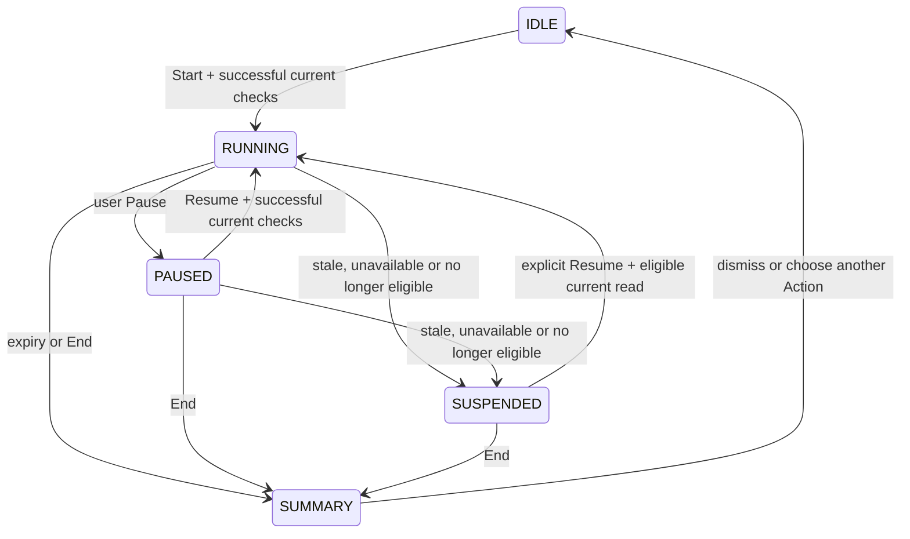

# Focus — business requirements document

Revision 1, 2026-11-01. Task: MC-FOCUS-BRD-20261101. Owner: Local Codex (BA/orchestration), with actual Codex Product Manager and Business Analyst subagent analysis. Status: **PROPOSED_IN_REVIEW / NOT_IMPLEMENTED**. This is an additive feature proposal requested by the PO; existing approved FR/RULE/AC identifiers and P0 acceptance remain intact. The document is an implementation specification candidate, not evidence that the feature is built or independently accepted.

Research and observation limits: [Pane assessment](../research/pane-focus-20261101/assessment.md). Current source inspected on `codex/unified-project-flow` at `64b9e0315e210953d7a7eaeacc0643b269a14ad9` plus dirty work. Reinspect the candidate before implementation.

## 1. Problem and intended outcome

A legal contributor needs to protect a short period for the next actionable obligation while moving between its Matter, documents and work details. My Work already answers what is ready and why; it does not retain a timed attention session across those screens.

**BR-FOCUS-01:** A signed-in contributor can start, control and end one private, time-boxed focus session linked to an authorized Ready Action, without altering the legal/operational truth of that Action or Matter. Each explicit +5 extends the chosen time box; this MVP specifies no cumulative duration cap and makes no hard maximum-session claim.

Success is easier concentration and return to context. Time elapsed is neither completion, proof, legal quality, attendance nor billable time. Focus expiry is not the Action's due date. Focus is optional; all current work commands remain usable without it.

## 2. Personas and journeys

| Persona / situation | Desired journey | Boundary |
| --- | --- | --- |
| Contributor preparing a transaction document | My Work → eligible Action → 25-minute focus → open related work/documents → pause/resume → end | Existing edit/upload/complete commands retain their own permission and conflict guards |
| Contributor interrupted by an external dependency | Running session → authoritative read shows waiting/blocked → session suspended with cause → inspect prerequisite | Do not turn waiting work into a Next Action |
| Returning contributor | Reload/reopen → revalidate private session and target → restore valid timer/context or explain interruption | No protected title flash or automatic identity carry-over |
| Matter OWNER/manager | Continue to see normal Matter state and assignments | No new view of colleagues' focus or individual productivity |

## 3. Proposed MVP and exclusions

Include one Focus card within My Work, searchable selection from eligible Actions, presets 15/25/50 minutes (default 25), Start/Pause/Resume/+5/End, a compact persistent control in the authenticated shell, and browser-local recovery. Choosing the currently shown eligible Action needs no second picker interaction. The timer must remain useful while the user reads another page.

Defer: unlinked “just focus”, Requirement-only/review-assignment targets, calendar blocking, automatic breaks, notification suppression, OS notifications/sound, daily goals/rings/totals, retained session history, team presence, manager monitoring, cross-device sync, timesheets/billing and AI prioritization. These require separate product/privacy contracts. No demo totals or invented progress may be shown.

Do not add a fifth bottom-navigation destination or another dashboard. Reuse My Work, existing searchable controls, domain-free primitives, Pane-inspired material, Be Vietnam Pro, icons with accessible labels and the current EN/VI system.

## 4. Functional requirements (new proposed IDs)

| ID | Required observable behavior |
| --- | --- |
| FR-FOCUS-01 | My Work offers Focus for the currently selected eligible Action. Candidates come from the backend's `next` list, keeping its order and reason. The user may choose another eligible Action; no client rescoring, inferred assignment or fallback to a blocked/Requirement item. A fresh authoritative read must validate Start/Resume. |
| FR-FOCUS-02 | Display Action title, accessible Matter name, why it is eligible, duration and current state. Never replace an unreadable name with a raw ID. If the current selection is Waiting/Blocked/History, explain why it cannot start Focus and offer the existing Ready queue. No candidates means an honest empty state, not a disabled unexplained button or invented task. |
| FR-FOCUS-03 | Presets are 15/25/50 minutes, default 25. Start begins the timer only; it must not call the Action Start/Complete command. Preset/target selection is locked during an active session; ending first allows another target. Changing the My Work selection or route must not silently retarget the running session. |
| FR-FOCUS-04 | Pause freezes remaining duration. Resume continues it after current authorization/eligibility validation. +5 adds exactly 300 seconds to a RUNNING or user-PAUSED session without changing its target; it does not unpause. Repeated clicks are distinct explicit operations, with concurrent same-revision updates prevented. Expired/ended sessions cannot be extended. |
| FR-FOCUS-05 | A compact controller persists across authenticated routes, exposing remaining time, target context, Pause/Resume, +5, End and a safe link back to the linked Action/My Work selection. Escape closes expanded controls only, preserves the session and returns keyboard focus to their trigger; End is always explicit. No fullscreen takeover or page navigation on timer ticks. |
| FR-FOCUS-06 | End and expiry yield “Session ended” / “Focus time is up”, with an optional Open Action next step. No automatic next session, work completion, evidence decision or route change. The end summary is transient; dismissing it clears it, and reload must not recreate a retained history item. |
| FR-FOCUS-07 | Internal navigation and reload retain a valid RUNNING/PAUSED session from timestamps and remaining duration, not an interval tick counter. Hidden tabs and sleep must not stretch a running session; paused time does not decrement. Restoration hides protected labels until authentication and target reads succeed. A clock discontinuity/corrupt record must lead to an explained suspension/reset, never negative, NaN or unbounded time. |
| FR-FOCUS-08 | There is at most one active private session per authenticated principal in the same browser profile/origin. Two tabs observe the same session and acknowledged control state; simultaneous Starts cannot create two. Stale controls cannot overwrite a newer Pause/End. The concurrency revision is a private-session revision, never a WorkItem revision. Without atomic shared coordination, Start is unavailable and ordinary My Work remains usable. A tab detecting coordination failure mid-session suspends its presentation and disables controls until safe reconciliation or reset; never claim global state remains synchronized during failure or silently downgrade to independent timers. Cross-device enforcement is excluded. |
| FR-FOCUS-09 | On the next authoritative observation of blocked/waiting/completed/cancelled/reassigned status, suspend the session and explain the permitted cause. Re-eligibility never auto-resumes. On missing membership/read permission, explicit unauthorized/forbidden/not-found, sign-out or account change, immediately hide/purge protected target/context and terminate the private record. Regrant must not revive it. Absence from `next` alone is not proof of access revocation: use authorized detail/reclassification where available, otherwise show a generic unavailable target without leaking a reason. |
| FR-FOCUS-10 | Transient network/API unavailability is a separate unverified/suspended condition, not empty, revoked or still-ready success. Stop presenting the Action as currently eligible. Retry is a read; resume requires successful current checks and explicit user action. No offline domain command or fresh idempotency key is generated by Focus. |
| FR-FOCUS-11 | Revalidate on Start, Resume, restoration, return to a visible tab, relevant route/data changes and a bounded visible-session refresh. Proposed maximum eligibility age is 30 seconds in visible RUNNING/PAUSED presentation: age is elapsed time since completion of the last successful authoritative eligibility read, not when a request began. Start a refresh early enough; absent success by the bound, suspend. The My Actions classification read is primary; authorized detail/assignment data disambiguates absence where available. This is a new UI freshness proposal, not the approved IdP introspection-cache TTL or a guarantee of instantaneous push revocation. No per-second API call; implementation must measure fan-out and provider effects. Existing stricter guards remain in force. |
| FR-FOCUS-12 | All controls are keyboard-operable with visible focus, useful EN/VI names, coherent screen-reader state and >=44px targets. Announce start/pause/end/suspension once, not each second. Respect reduced motion/transparency; do not rely on a ring/color alone. On <=800px, coexist with the bottom dock and safe areas; never cover action buttons, input focus, dialog controls or reading content at 320px/200% zoom. |
| FR-FOCUS-13 | Browser-local private storage contains only necessary opaque identity/scope/Action references, lifecycle/version and timing data; no titles, descriptions, client/legal text, tokens or credentials. Validate stored data as untrusted. Do not put session state or protected text into URL, telemetry or public logs. Local durations and references are still private user data, not a security boundary. |
| FR-FOCUS-14 | Persist only the current resumable session. Remove it on End/expiry, logout/account change or access loss; recovery after ordinary navigation/reload is allowed only within the valid authenticated lifetime. Do not record session results, daily counters or manager reports. Blocked browser storage must fail honestly without breaking ordinary My Work. |

The browser's own local state is not an authorization source. Current server permissions and legal guards always win, including an access check before following a linked record. Focus does not grant editing/verifier permission. Starting the personal aid may be available to a member whose assigned Action is eligible, but the next business command is governed independently by the existing matrix.

## 5. State and interruption semantics

These are private UI states, never values in WorkItem execution/dependency/verification/timing/attention.

- Restoration temporarily enters a checking presentation before revealing the target. A valid paused session stays paused; a valid running session recalculates remaining time, then resumes presentation. On detecting a passed deadline, immediately remove the persisted session/reference even if offline and show only a generic in-memory expiry message. Target names/links require successful current authentication and scope reads; another reload cannot recreate the summary.
- SUSPENDED freezes remaining time when the interruption is detected and persists the same minimal identity/reference/version/frozen-duration record, without protected labels, only within the authenticated lifetime. Its former running deadline no longer decrements it. Reload remains SUSPENDED; successful validation plus explicit Resume or End is required. No later claim is made that unobserved/offline time represented actual work. +5 is unavailable in SUSPENDED.
- Explicit access/session loss overrides every state: purge to IDLE with a generic non-sensitive explanation in the receiving tab and notify visible sibling tabs immediately through shared coordination. Background tabs must revalidate/purge before revealing protected context on refocus. A closed browser purges stale/session-mismatched records at the next origin execution before rendering. No protected summary or old draft should flash on a shared machine. This is observation-based cleanup, not a promise of instantaneous server push.
- SUMMARY is not an active persisted session, WorkItem history entry, timesheet or completion assertion. Do not increment any business counter.

## 6. Non-negotiable business invariants

1. RULE-001/002/021 remain unchanged: focusing is not executing/completing a Requirement, and an assignment alone is not an eligible recommendation.
2. Start/Pause/Resume/+5/End/expiry issue **zero domain write commands**. Action revisions, evidence, dependency truth, ownership, due/attention and domain-event rows remain unchanged. Ordinary read/security logs may still exist; do not promise zero logging.
3. Editing/completing work during Focus uses the existing explicit operation, idempotency/CAS and UNKNOWN reconciliation. Focus never repeats a command, auto-confirms it, clears a form or creates a replacement attempt.
4. No Focus scope may disclose a confidential Matter through cached text, search choices, counts, a summary or another user's browser session.
5. A timer is a personal aid, not measured active work. No time entry, performance score, “notifications muted” claim or legal conclusion is produced.

## 7. Acceptance matrix (all NOT_RUN for MatterControl Focus)

| ID | Given / when | Required result |
| --- | --- | --- |
| AC-FOCUS-01 | Ready contains assigned eligible A1/A2 plus excluded Requirement, waiting, blocked and terminal fixtures | Only authorized `next` candidates, same server order/reasons; default shown eligible Action; no invented fallback |
| AC-FOCUS-02 | A1 is already the shown eligible Action with default 25; activate Start | One Start activation enters RUNNING 25:00; title/Matter/context correct; domain state/revision/events unchanged. Alternate target/duration interactions are recorded separately, with no invented three-click limit on a searchable picker. |
| AC-FOCUS-03 | Pause at 24:37, advance fake clock, +5, Resume | Paused stays 24:37; +5 yields paused 29:37; resumed countdown follows elapsed time |
| AC-FOCUS-04 | Navigate to another Matter/Workspace and back | Same original focus target; no implicit retargeting; contextual return preserved; no form unmount/draft/UNKNOWN loss caused by controls |
| AC-FOCUS-05 | Reload RUNNING/PAUSED/SUSPENDED; background/sleep ten minutes; reload offline after deadline | Restore authorized labels only after current checks; elapsed running interval counted, paused/suspended interval excluded. Passed deadline clears the persisted record immediately and shows a generic transient message even offline, with no target link until validated. Reload cannot recreate it. |
| AC-FOCUS-06 | User End or deadline expiry, then reload | Only private session ends; no Action completion/verification/mutation, no retained result/daily aggregate, no auto-next session |
| AC-FOCUS-07 | Same principal has two tabs, including simultaneous Start and racing Pause/+5/End | One shared session; versioned accepted updates converge; End cannot be resurrected by a stale tab; one expiry presentation per session per tab without duplicate effects |
| AC-FOCUS-08 | Action becomes waiting/blocked/completed/cancelled/reassigned | Next current read suspends with authorized explanation; no false Ready badge; return to eligibility does not auto-resume |
| AC-FOCUS-09 | Workspace/Matter rights revoked; account changes; logout; regrant later | Explicit failure purges immediately in the observing tab and visible sibling tabs via coordination; hidden tabs purge/revalidate before revealing context on refocus; closed-browser cleanup precedes the next render. No stale title flash or revival; reads/links retain default deny. |
| AC-FOCUS-10 | API 503/network failure during validation; recovery | Explicit unverified suspension, not empty/access-loss/success; bounded retry reads; resume requires user action and successful checks |
| AC-FOCUS-11 | Empty ready queue, missing/inaccessible label, malformed or foreign-principal stored record | Explain no eligible work; no ID fallback; reject/purge invalid state safely; ordinary My Work still works |
| AC-FOCUS-12 | Visible session, navigation/refocus and validity deadline | Immediate event-triggered read plus bounded periodic freshness; no stale-ready claim beyond proposed 30s bound; no per-second API traffic; record actual interval/error handling |
| AC-FOCUS-13 | EN/VI, light/dark, 320/390/768/800/801px, 200% zoom, long legal titles, bottom dock and open dialog | Reachable non-overlapping controls; names distinguish duration from due date; real focus order/Escape/return-focus; reduced-motion fallback |
| AC-FOCUS-14 | Keyboard + screen reader operation from My Work through Start/Pause/Resume/End | Named target, duration, state; event-only announcements; no countdown announcement storm or unsolicited OS permission |
| AC-FOCUS-15 | Focus actions + explicit real Action completion/conflict/UNKNOWN fixture | Focus cannot bypass real guards, mutate twice, erase intent or label unknown outcome as success; only confirmed real readback changes work state |
| AC-FOCUS-16 | Storage disabled, corrupt timing, backward wall-clock jump, forward jump beyond deadline, or failed shared coordination | Explained safe suspension/reset on clock discontinuity unless a trusted elapsed source can establish actual expiry; ordinary hidden-tab elapsed time is not a clock fault. No atomic coordination means Start unavailable; detected mid-session failure suspends/disables controls until reconciliation/reset. No duplicate timers, NaN/negative duration or loss of normal page access. |
| AC-FOCUS-17 | Inspect storage, requests and output/log capture | No sensitive titles/body/token persisted by Focus, no new domain write or history/stats endpoint; cleanup removes resumable private record |
| AC-FOCUS-18 | Proposed 5-user uncoached trial, representative synthetic tasks | Target >=4/5 can start/pause/end, identify the linked Action and distinguish Focus expiry from due/completion/billable time. Record time/accuracy; this new trial does not satisfy or rewrite AC-137 |

## 8. Traceability and impact

| Existing authority / implementation | Preserved behavior | New proposed scope |
| --- | --- | --- |
| FR-003; RULE-021; AC-103/144 | Server eligibility/order, explanation and no invented work | FR-FOCUS-01..03; AC-FOCUS-01/02/11 |
| FR-010; AC-110 | User-scoped My Work | Entry and personal session target |
| RULE-001/002/003/018/019 | Independent states, prerequisites, explicit CAS/idempotency and real history | Zero domain writes; AC-FOCUS-06/15/17 |
| RULE-017; FR-018; AC-147 | Workspace/Matter permissions and revocation | Browser purge/revalidation; AC-FOCUS-08..12 |
| AC-151/152/156 | Accessibility, local-time semantics, unavailable distinct from empty | Timer/duration UX, real responsive/error checks |
| AC-137 | Existing Control Room comprehension protocol | Retained untouched; separate AC-FOCUS-18 trial proposed |
| MyActionsView / selectMyWork | One current item and URL selection/context | Focus entry only; no new route/queue/ranking |
| Shared shell / bottom dock | Existing navigation and focus/draft behavior | Domain-aware feature composed into a safe shell slot |

## 9. Recommendations and decision record

These are PM/BA recommendations for this new feature, not retroactive PO approvals or changes to settled legal rules:

| Candidate decision | Recommendation and implication |
| --- | --- |
| FOCUS-D01: target scope | Eligible assigned Action only. General focus and verifier/review focus can follow under separate requirements. |
| FOCUS-D02: persistence/privacy | Browser-local current session only; no backend migration/history/cross-device promise. Same-profile cross-tab coordination still required. |
| FOCUS-D03: timing controls | 15/25/50, default 25, +5, manual End. No minimum-duration/session-count policy needed because nothing is counted. |
| FOCUS-D04: stale/ineligible handling | Suspend and explicitly revalidate/resume; purge on actual access/session loss. Proposed visible refresh bound 30s must be validated for provider/request load before production commitment. |
| FOCUS-D05: non-goals | No notification suppression, billing, team visibility or aggregates in this MVP. |

No request is made to reapprove existing P0 direction, Next Action rules, permission matrix or infrastructure. Server history/sync, new data retention, performance/cost promises or policy changes require their own approval if later proposed. Current deliverable stops at requirements and handoff, as requested.

## 10. Delivery and verification plan

Implement as one coherent frontend feature with stages for traceability, not repeated user handoff pauses: (1) current-source gap map and confirmed scope, (2) tested timer/persistence/concurrency core, (3) My Work and shell composition, (4) authenticated interruption/privacy/error checks, (5) responsive/a11y/browser journey and nonauthor review.

Use existing Next.js/Go REST boundaries and repository pattern. Prefer current endpoints and installed dependencies; no source-level architectural rewrite or provider change. A missing refresh/coordination capability must be named and solved within an authorized narrow contract; do not invent an existing endpoint or ship a cosmetic countdown with false guarantees.

Required evidence: actual source revision/changed-file pins; command/UTC/exit receipts; fake-clock and concurrency tests; real authenticated browser captures; before/after domain revision/event checks proving no mutation; storage privacy/cleanup checks; calls/error census; measured visible revalidation behavior; explicit run/not-run matrix. Author tests and later independent acceptance stay distinct. See the [full implementation handoff](../implementation/handoffs/MC-FOCUS-MVP-IMPLEMENTATION-PROMPT.md).
