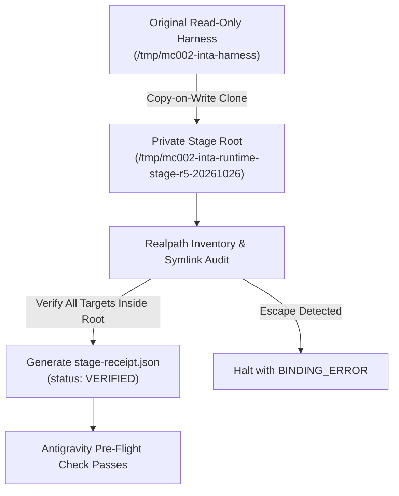

# MatterControl — Dependency Isolation Plan R5

**Task**: `MC-002-INTA-FE-VALIDATION-R5`  
**Status**: `PROPOSAL_FOR_REVIEW / RUNTIME_NOT_RELEASED`  
**Owner Boundary**: Antigravity (Specification & Validation) / Local Codex (Provisioning & Staging)  

---

## 1. Objectives & Boundaries

This plan details the isolation architecture and pre-flight integrity verification for frontend validation dependencies, addressing findings **NF-1, NF-5, R4-C02, and OpenCode §4.2**.

### Strict Staged Boundaries:
- **No Shared Modification**: The original harness at `/tmp/mc002-inta-harness` is strictly read-only reference data.
- **Dedicated Private Staging Root**: `/tmp/mc002-inta-runtime-stage-r5-20261026` is reserved for Codex staging operations.
- **Antigravity Non-Execution of Staging**: Antigravity does **not** copy or install packages; Antigravity provides the fail-closed validation logic that enforces the staging receipt before any child execution.

---

## 2. Codex Staging Execution Plan

Codex will execute the following staging pipeline prior to any combined independent readiness review:



### Staging Procedure:
1. **Directory Creation**: `mkdir -p /tmp/mc002-inta-runtime-stage-r5-20261026`
2. **CoW Copy**: `cp -R -p -c /tmp/mc002-inta-harness/* /tmp/mc002-inta-runtime-stage-r5-20261026/`
3. **Symlink Boundary Audit**:
   - Traverse all links in `node_modules/.bin/` and `node_modules/.pnpm/`.
   - Resolve canonical realpath for every target.
   - Reject any symlink that resolves outside `/tmp/mc002-inta-runtime-stage-r5-20261026`.
   - Reject any symlink resolving to sensitive paths (e.g., `~/.ssh`, `/etc`, `/var/root`).
4. **Receipt Generation**:
   - Write `/tmp/mc002-inta-runtime-stage-r5-20261026/stage-receipt.json` declaring:
     ```json
     {
       "stageRoot": "/tmp/mc002-inta-runtime-stage-r5-20261026",
       "stageStatus": "VERIFIED",
       "timestampUTC": "2026-10-26T...",
       "nextBin": "/tmp/mc002-inta-runtime-stage-r5-20261026/node_modules/.bin/next",
       "symlinksAudited": 142,
       "symlinkEscapes": 0
     }
     ```

---

## 3. Coordinator Pre-Flight Enforcement

In `runner/coordinator.py`, `validate_preflight_stage()` checks:
1. When `stage_receipt_required=True`:
   - Checks existence of `/tmp/mc002-inta-runtime-stage-r5-20261026/stage-receipt.json`.
   - Validates JSON parse and requires `stageStatus == "VERIFIED"`.
   - If missing or unverified, halts immediately with `[BINDING_ERROR/NOT_READY]` before spawning either observer or child.
2. Checks launcher script and Node binary existence at absolute bound paths.

In in-process self-checks, simulated mock receipts and fake filesystems verify both the passing path and the missing-receipt fail-closed path (SelfCheck test 44).
