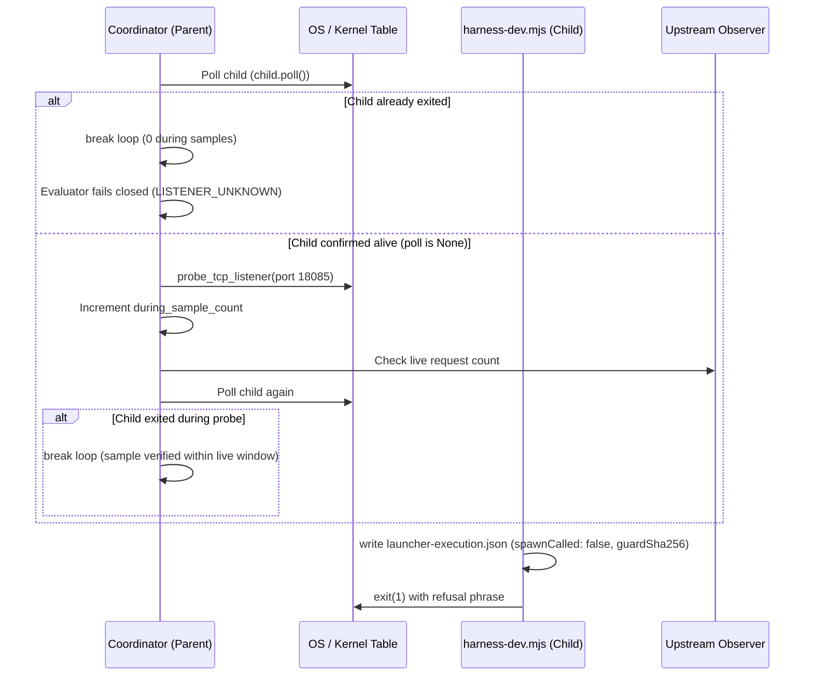

# MatterControl — Fast-Refusal Lifecycle-Bound Proof Basis R5

**Task**: `MC-002-INTA-FE-VALIDATION-R5`  
**Status**: `PROPOSAL_FOR_REVIEW / RUNTIME_NOT_RELEASED`  
**Requirement**: `INT-ENV-05`, `INTA-1-LAUNCH-01`  
**Resolves**: `R4-C01`, `NF-4`, `R2-I04`, OpenCode §4.1  

---

## 1. Problem Statement: Why Ordering Alone Is Not Proof

In R4, sampling was performed at the top of the monitor loop before `child_proc.poll()`. OpenCode Review §4.1 demonstrated that this ordering did not prove child liveness:
- An already-exited or dead child process was sampled once by `lsof`, incrementing `during_sample_count = 1`.
- SelfCheck test 34 constructed a `MockChildProcess(returncode=1)` that was dead from creation, yet evaluated to PASS.
- In-memory `spawnCalled: false` was not persisted to disk by the CLI, leaving point 3 of the proof unverified by retained evidence.
- Pre-flight port detection fabricated `during_sample_count = 1` despite zero child execution.

---

## 2. The R5 Lifecycle-Bound Proof Architecture

R5 establishes a verifiable, fail-closed proof model grounded in immutable OS evidence and retained disk records:

---

## 3. Four Core Pillars of the R5 Proof

### Pillar 1: Verified Live Interval Conditioning
- Probes are strictly conditioned on `child_proc.poll() is None`.
- If the child exits before the probe, the loop breaks immediately.
- Zero samples are counted for dead children (`during_sample_count = 0`).
- Evaluator enforces `during_sample_count > 0`; zero samples fail closed as `LISTENER_UNKNOWN`.

### Pillar 2: Elimination of Synthetic Evidence
- Removed the synthetic `during_sample_count = 1` from the pre-flight port-occupied path.
- Pre-flight occupied port returns `during_sample_count = 0` and fails closed on `listener_during = True`.

### Pillar 3: Attempt-Bound Launcher Execution Record
The launcher atomically writes `launcher-execution.json` into `MC_INTA_STATE_DIR` before process exit, capturing:
- `launcherPath` and `launcherSha256`
- `guardPath` and `guardSha256`
- `nodePath` and `nodeVersion`
- `pid`, `ppid`, `argv`, `cwd`, and `timestampUTC`
- `spawnCalled`: boolean (`false` on startup refusal)
- `outcome`: `"REFUSED_BEFORE_SPAWN"`
- `refusalMessage`: exact refusal text
- `exitCode`: `1`

The evaluator reads and correlates this file:
- If `spawnCalled` is not `False`: fails closed as `SPAWN_CALLED_ON_REFUSAL`.
- If `guardSha256` mismatches: fails closed as `GUARD_HASH_MISMATCH`.
- If `outcome == "BINDING_ERROR"`: fails closed as `BINDING_ERROR`.

### Pillar 4: Deterministic Self-Check Proof
- **Test 34 (Dead Child Rejection)**: Proves that a dead child mock produces 0 samples and fails closed as `LISTENER_UNKNOWN`.
- **Test 35 (Live-Then-Exit Verification)**: Proves that a child alive during the probe produces `during_sample_count = 1` and passes all gates.
- **Test 36 (Spawn-Immediate-Exit Defect)**: Proves that an immediate-exit child fails closed as `LISTENER_UNKNOWN`.
