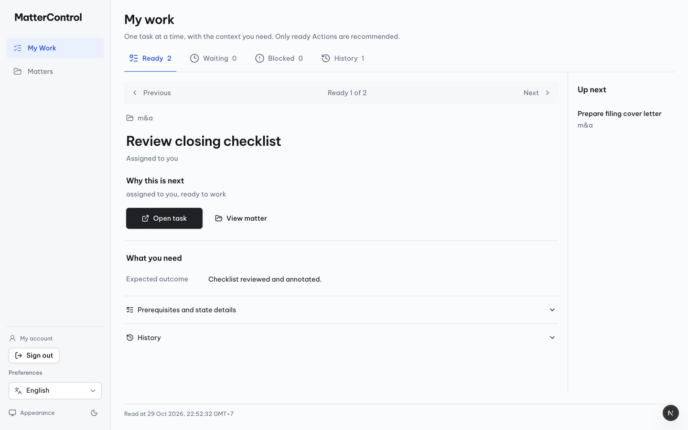
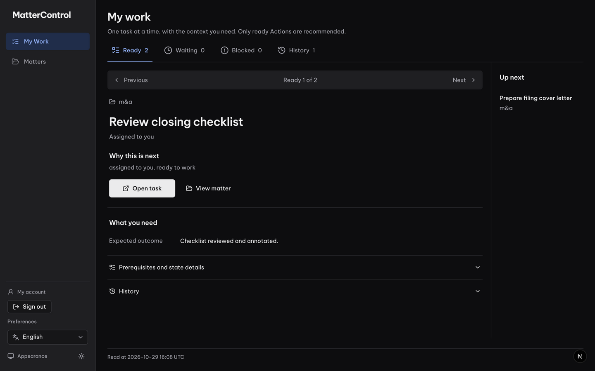
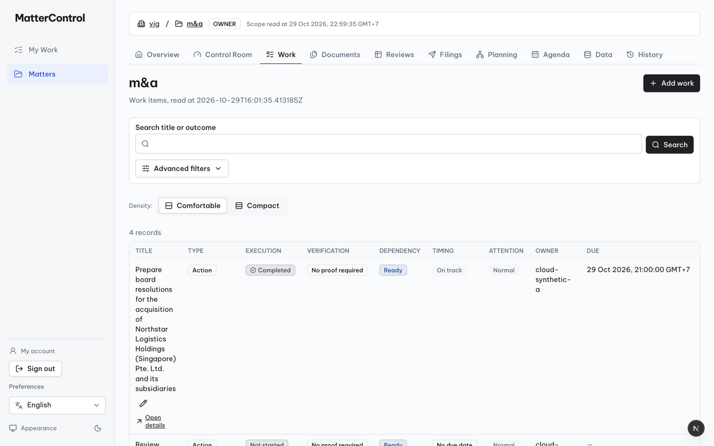
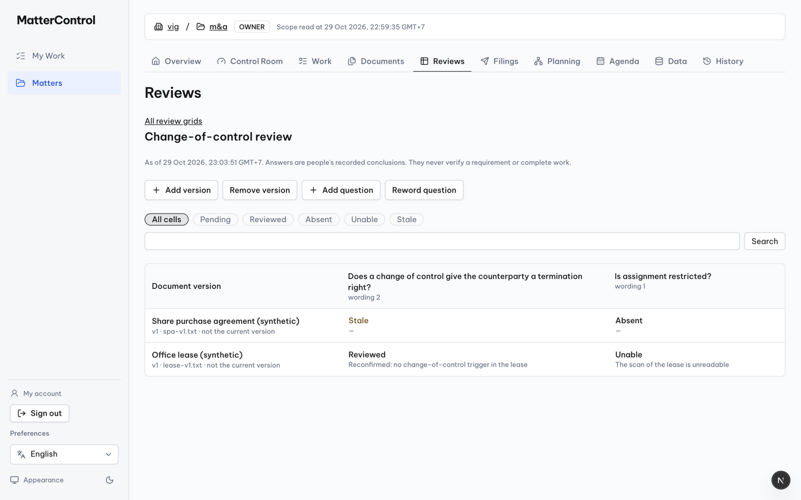
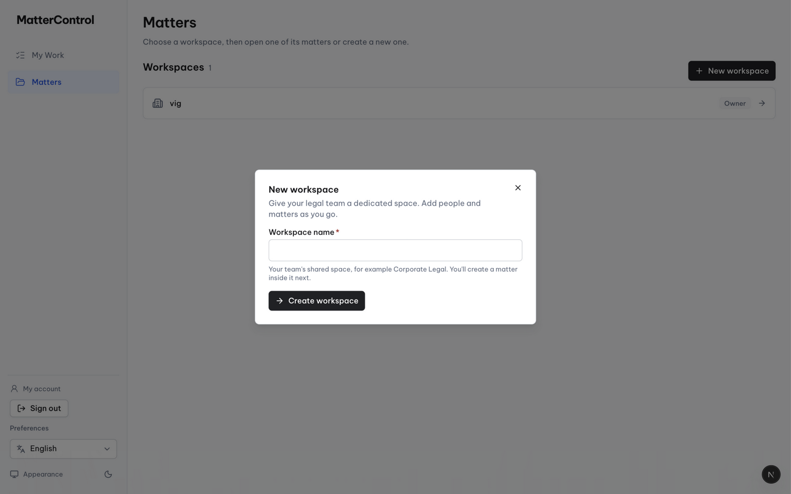
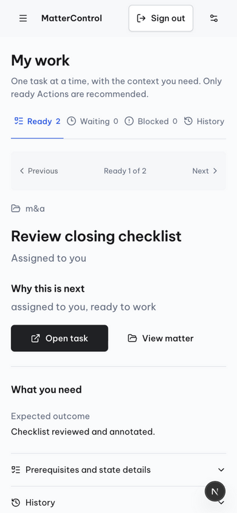
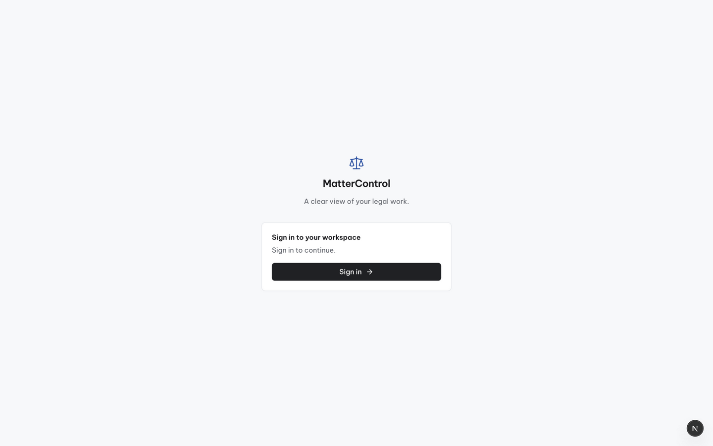
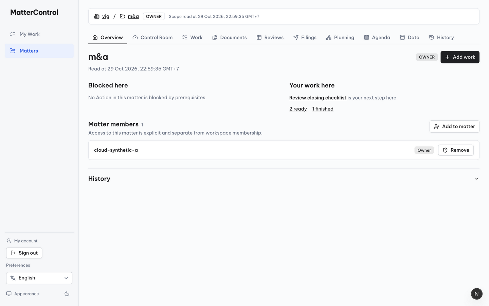
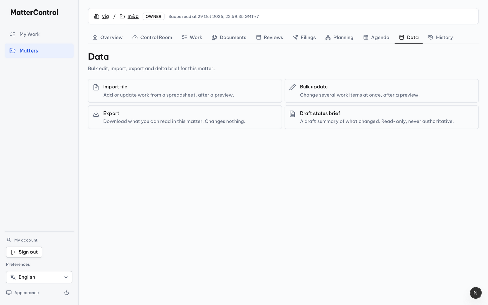

# Side-by-side button comparison sheet — audit evidence (not a product screen)

Compiled from permitted screenshots of the owner's retained dev runtime (:3000, RUNTIME_REVISION_UNCONFIRMED) and the committed reference artifact sources. Same conditions per row: 1440×900 or 390×844 CSS px, dpr 1, light unless noted, EN.

## 1. The workbench CTA pair (product vs product's own ghost, vs approved reference)

| | Product "Open task" (work-primary) | Product "View matter" (ghost md) | Reference `.primary` (committed styles.css / concept-3.png) |
|---|---|---|---|
| Border box | **160×44** | 132.7×36 | **min 200×56** |
| Font | 14px / 500 / lh20 | 14px / 500 / lh20 | 16px / lh1.5 |
| Padding | 10/16/10/16 | 6/12/6/12 | 12/21/12/21 |
| Surface | #202124 + white, radius 6, shadow-xs | transparent, fg text | #202124 + #fff, radius 6, shadow |
| Icon | 16 | 16 | 21 (prototype global svg) |
| Verdict | INTENTIONAL_VARIANT (PO density amendment superseded the 200×56/16px numbers) | INTENTIONAL_VARIANT (secondary action) | reference only — superseded for the product |

## 2. Same-verb "Search" submit on the two grids (the confirmed same-family mismatch)

| | Work grid Search (`Button` primary md) | Reviews Search (raw `<button>` outline) |
|---|---|---|
| Border box | 96.6×**36** | 73.9×**32** |
| Surface | #202124 dark primary, white text | white card, 1px #cdd1d6 border |
| Font weight | 500 | 400 |
| Input beside it | 40px (`min-h-10`) | 32px (custom `control-target`) |
| Verdict | **INCONSISTENT (F-01)** — one of the two should change |

## 3. Adjacent field vs button height (F-02)

| Context | Input | Submit button |
|---|---|---|
| Work search row | 40px | 36px |
| New-workspace dialog | 40px (462 wide) | 36px (175.7 wide) |
| Reviews search row | 32px | 32px |

## 4. Chip families (F-03)

| | Work applied-filter chip | Review state chip |
|---|---|---|
| Height | 36 (`min-h-9`) | 22 (content only) |
| Text | 12px (text-xs) | 14px (text-sm) |
| Surface | bg-muted, border | transparent / primary-10 active |
| Radius | full | full |

## 5. Responsive touch contract (control-target at 390)

All measured 44px min at 390×844: queue tab 44, Step 44, CTA 160×44, View matter 44, disclosure 53. `scrollWidth` 390 = no overflow. Bare `underline` summaries outside the workbench are expected to stay ~20px on touch (F-06, SOURCE_ONLY).

## 6. States

| State | Evidence |
|---|---|
| Disabled (token style) | Data page Preview/Commit: bg #f5f7f9 + text #626973 (M-43) |
| Disabled (Step) | aria-disabled span, #626973, 26px desktop / 44px touch (M-17/M-39) |
| Dark theme | primary → oklch(0.94) surface + dark text (M-42) |
| Sign-in failure | ReadFailure primary md CTA (M-05), EmptyState family |
| Loading | source-only (Button `loading` → spinner + aria-busy); not exercised live |
| VI | labels did not switch server-side on the old runtime (M-…, screenshot product-my-work-1440-vi.png) — NOT_VERIFIED |

Reference truth for row 1: `docs/design/legal-team-experience-20261029/concepts/concept-3.png` (sha256 88c32cee…) — approved visual direction; its exact numbers were superseded for the product by the PO typography/density amendment recorded in `docs/implementation/tasks/MC-P0-CODEX-UI-FIDELITY-20261029.md`.
